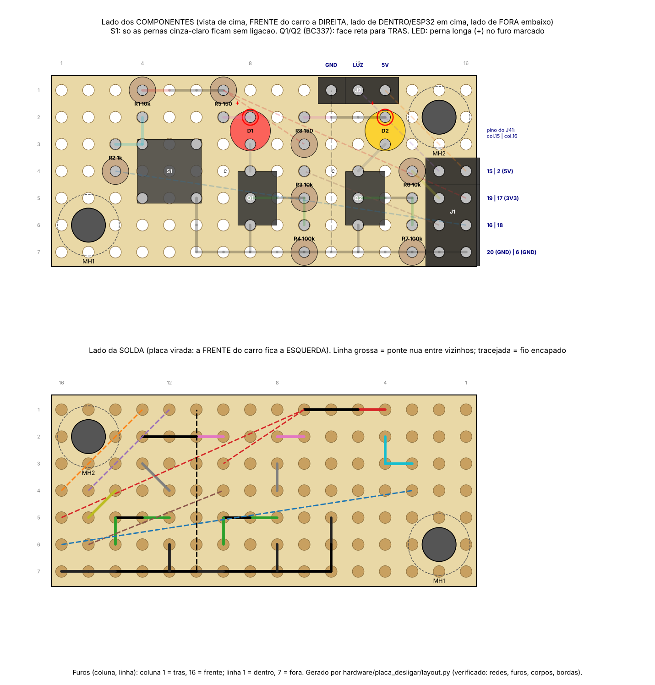

# Placa de interface: desligar a Jetson, luz da câmera e LEDs (placa extra, 40 × 18 mm)

Uma plaquinha perfurada (**16 × 7 furos**) no **andar 3** do chassi v4, à direita da placa da ESP32, com 2 parafusos
M3, mais um **módulo da luz** pequeno junto da luz, no mastro da câmera. Liga só na barra **J41 da Jetson** (8 jumpers:
pinos 15–20, 2 e 6). A placa da ESP32 v0.8 **não muda**.

**Coerente com o chassi:** o J1 (jumpers do J41) fica na borda da **frente**, de frente para o passa-fio do J41; o
J2 (cabo da luz) fica na borda de **dentro**, do lado do mastro; botão e LEDs ficam por cima. As posições de tudo
(e os 2 furos no andar 3) saem do mesmo arquivo, `layout.json`, que o modelo do chassi lê.
Decisões: [D-028](../../docs/decisoes.md) (desligar) e [D-033](../../docs/decisoes.md) (luz e LED do código).
A pasta continua `placa_desligar/` para não quebrar os links.

| O que | Pino do J41 | Quem controla | Significa |
|---|---|---|---|
| Botão de desligar | 18 (gpio15) | serviço `botao-desligar` (root) | segurar **2 s** = desligar a Jetson com segurança |
| LED **vermelho** | 16 (gpio232) | serviço `botao-desligar` | aceso = Jetson ligada; **apagou = pode desligar a chave** |
| LED **amarelo** | 19 (gpio16) | `seguir_linha.py` | **pisca 1 Hz** = programa do robô rodando, esperando a largada; **4 Hz** = andando; **parado** (aceso ou apagado) = programa fechado ou travado |
| **Luz da câmera** (branca) | 15 (gpio194) → J2 → MOSFET no módulo da luz | `seguir_linha.py` e `calibrar.py` | acesa = câmera aberta e mandando quadros; apaga se a câmera parar (5 quadros seguidos sem imagem) ou o programa sair |
| 3,3 V / GND / 5 V | 17 / 20 e 6 / 2 | — | alimentação dos LEDs / referência / alimentação da luz |

Não há LED separado de "câmera ligada": a própria luz faz esse papel (D-033).

## LED vermelho (desligar)

| LED vermelho | Significa |
|---|---|
| apagado logo depois de ligar a chave | Jetson iniciando (acende em ~20 s, quando o Linux sobe) |
| **aceso** | Jetson ligada: **não desligue a chave** |
| pisca rápido 1,5 s | o botão foi aceito: a Jetson está desligando |
| aceso de novo | ainda desligando (gravando o cartão) |
| **apagou** (com a chave ligada) | **pode desligar a chave** |

O LED é ligado pelo Linux e **nunca é apagado por software**: quem o apaga é o corte de energia do módulo da Jetson,
no fim do desligamento. Por isso "apagou" é uma informação confiável.

**Procedimento:** segurar o botão 2 s → LED pisca → esperar **apagar** (10–25 s) → desligar a chave geral.
Reserva (sem a placa): com o robô parado, segurar o botão de **largada** da ESP32 por 3 s.

## O que entra nesta placa e o que não entra (decisão técnica)

| Pedido | Decisão | Por quê |
|---|---|---|
| Juntar tudo numa placa só | **Sim para tudo que é sinal**: botão, 2 LEDs, saída da luz e o conector do J41 | é tudo do J41; uma placa, um chicote |
| Pôr o **fusível** junto | **Não**: o fusível fica na placa dele, no andar 2, logo depois da bateria | o fusível protege o **fio** que sai da bateria; tem de ficar o mais perto dela possível. Trazê-lo para o andar 3 deixaria ~15 cm de fio da bateria **sem proteção** subindo ao lado da Jetson, e poria 12 V / 7 A a um furo de distância dos pinos de 3,3 V da Jetson (uma ponte de solda e o J41 queima) |
| Refazer a **placa da ESP32** com tudo integrado | **Não antes da competição** (fica para a v0.9) | é ela que move os motores; corroer e soldar de novo a 3 dias do congelamento arrisca o carro inteiro para ganhar só "uma placa em vez de duas". E estas funções são da **Jetson**, não da ESP32 |
| Placa de até 10 × 10 cm | **40 × 18 mm** | é o espaço livre ao lado da ESP32 no andar 3; maior bateria nos passa-fios dos motores e do J41 |
| MOSFET da luz na placa | **No módulo da luz** (junto da luz) | a placa fica sem a peça grande (TO-220) e o módulo é a única parte que depende da luz que vocês compraram |
| Botão **com trava** de 6 pinos | **Não usar** | para desligar a Jetson o botão tem de ser de **pulso** (aperta e volta). Com trava, ele fica apertado: desliga e, no boot seguinte, continua apertado. Para a bateria ele também não serve: esses botões aguentam pouca corrente (é comum 0,1–0,5 A; confira o que está escrito no anúncio) e o carro puxa alguns ampères. Usar a **chave táctil 6 × 6** (pulso) no botão e a **KCD1** na bateria |

## Por que assim (comparação)

| Opção | Funciona com o programa do robô travado? | Indicador confiável de "pode desligar"? | Hardware novo |
|---|---|---|---|
| Largada segurada 3 s → ESP32 → flag → `shutdown` (já existe) | **não**: depende do `seguir_linha.py` e do USB | não (o LED da ESP32 continua aceso porque o USB da Jetson segue alimentando a ESP32) | nenhum |
| Botão de força do header J50 da Jetson + `HandlePowerKey` | sim | não (o LED verde da Jetson fica no 5 V e não apaga) | 2 fios, mas a pinagem do J50 da B01 **não pôde ser confirmada** (sites da NVIDIA bloqueados nesta sessão) e o J50 fica embaixo do módulo |
| Comando pela ESP32 via USB (outro botão na ESP32) | não (mesmo problema do 1º) | não | placa da ESP32 mudaria (vetado) |
| **GPIO do J41 + serviço próprio + LED pelo GPIO** (escolhida) | **sim**: serviço separado, como root | **sim**: o GPIO só cai quando o módulo desliga | esta plaquinha (peças de laboratório) |

A opção 1 continua valendo como **reserva** (nada foi tirado do firmware nem do `seguir_linha.py`).

## Esquema

```
J41 pino 17 (3V3) ──┬── R1 10k ──┬── R2 1k ──── J41 pino 18 (gpio15, entrada)
                    │            │
                    │           S1 botão (NA)
                    │            │
                    │           GND
                    │
                    ├── R5 150 Ω ──► D1 LED vermelho ──── C  Q1 BC337
J41 pino 16 (gpio232) ── R3 10k ──┬─────────────────────── B
                                  R4 100k
                                  │
J41 pino 20 (GND) ────────────────┴─────────────────────── E
                    │
                    └── R8 150 Ω ──► D2 LED amarelo ───── C  Q2 BC337
J41 pino 19 (gpio16) ─── R6 10k ──┬─────────────────────── B
                                  R7 100k
                                  │
                                 GND ───────────────────── E

J1 (pinos 2, 15, 6) ────────────── J2 (5V, LUZ, GND) ── cabo de 3 fios ── MÓDULO DA LUZ (no mastro):

  5V ────────────────────────────────► (+) LUZ (fita 5 V ou LEDs com resistor)
                                       (−) LUZ ──────────────── D  Q3 IRLZ44N
  LUZ (pino 15) ── R9 1k ─────────┬──────────────────────────── G
                                  R10 100k
                                  │
  GND ────────────────────────────┴──────────────────────────── S
```

* R4, R7 (na placa) e R10 (no módulo da luz) seguram base/porta em 0 V quando o pino está solto (Jetson desligada, iniciando, ou serviço
  parado): **tudo apagado**. Por isso o amarelo apagado no boot é normal até o programa do robô começar.
* Os pinos do J41 passam por um conversor de nível (TXB0108) que **não aguenta carga**: tudo é ligado por transistor.
  Pela base do BC337 passam ~0,2 mA, o suficiente para um LED de ~9 mA, **não** para a luz. A luz vai por MOSFET,
  cuja porta não puxa corrente.
* **Q3 (no módulo da luz) tem de ser IRLZ44N** (com **L**: liga com 3,3 V na porta). IRFZ44N, IRF540N e IRF3205 precisam de ~10 V na
  porta e **não ligam direito** com 3,3 V. Sem IRLZ44N: TIP120 com R9 = 1k (perde ~1 V; a luz fica mais fraca) ou
  AO3400/SI2302 (SMD).
* R2 (1k) protege o pino 18 se ele for configurado como saída por engano. R9 (1k) limita o pico de carga da porta.
* LEDs indicadores: (3,3 − 1,9 − 0,1) / 150 ≈ 9 mA. Vermelho, amarelo ou verde servem; **não** use azul/branco como
  indicador (Vf ≈ 3 V não acende bem em 3,3 V).
* Luz: alimentada pelos **5 V regulados** (XL4016 #1, via pino 2 da Jetson), **não** pela bateria: o brilho não cai
  quando a bateria descarrega, então a calibração continua valendo do começo ao fim da bateria.
* Os números do sysfs (gpio15, gpio232, gpio194, gpio16) foram conferidos em `gpio_pin_data.py` do `jetson-gpio`.

## Peças

| Ref | Peça | Obs |
|---|---|---|
| S1 | chave táctil 6 × 6 mm com haste de **13 mm** | haste alta = aperta com o dedo por cima sem tirar nada |
| D1 | LED vermelho 3 mm | "Jetson ligada / apagou = pode desligar" |
| D2 | LED amarelo 3 mm | "código rodando" |
| Q1, Q2 | BC337 | olhando a face chata, pernas da esquerda para a direita: C, B, E |
| R1, R3, R6 | 10 kΩ | |
| R2 | 1 kΩ | |
| R4, R7 | 100 kΩ | |
| R5, R8 | 150 Ω (100–220 Ω) | |
| PCB | placa perfurada **40 × 18 mm (16 × 7 furos)**, ilhas isoladas | furos de 3,2 mm em MH1 (2,6) e MH2 (15,2); já no andar 3 do v4 |
| J1 | barra de pinos **macho 2 × 4** | recebe 8 jumpers Dupont fêmea-fêmea de 15 cm vindos do J41 (pinos 15–20, 2 e 6) |
| J2 | barra de pinos **macho 1 × 3** | cabo de 3 fios de ~25 cm até o módulo da luz |
| — | fio fino encapado (30 AWG ou cabinho) ~30 cm + perna cortada de resistor para as pontes | 7 fios encapados e 32 pontes curtas (ver desenho) |

**Módulo da luz** (pedacinho de placa perfurada de ~20 × 15 mm, colado/parafusado atrás da luz): Q3 **IRLZ44N**
(olhando a face com o texto: G, D, S), R9 1 kΩ, R10 100 kΩ, barra macho 1 × 3 (5V, LUZ, GND, na mesma ordem do J2)
e os 2 fios da luz. O suporte da luz no mastro entra no chassi quando soubermos qual luz é (ver "Luz da câmera").
| M1, M2 | 2 parafusos M3 × 10 + 2 espaçadores M3 de 3 mm + porcas | fixação no andar 3 |

### Luz da câmera (comprar)

| Opção | Onde/quanto (ESTIMATIVA) | Por quê |
|---|---|---|
| **1 (recomendada)** fita LED **5 V** branca fria (6000–6500 K), **SMD 2835**, 60 LEDs/m — a "fita USB para TV" | loja de eletrônica ou de iluminação, R$ 10–20 o metro | espalha bem (120°), corta a cada 3 LEDs (5 cm), já tem resistor, adesiva. Usar **2 trechos = 10 cm, 6 LEDs** |
| 2 (se não achar até 29/11) 4 LEDs brancos 5 mm alto brilho + 4 resistores de 100 Ω | laboratório, ~R$ 2 | (5,2 − 3,1)/100 ≈ 20 mA cada. Feixe estreito (20–30°): mais mancha clara no meio, usar difusor |
| **Não** comprar | fita de **12 V** | ligada na bateria, o brilho muda com a carga; nos 5 V nem acende |

Difusor: papel vegetal ou 2 voltas de fita crepe na frente dos LEDs (tira o reflexo duro no tapete).
Consumo esperado (ESTIMATIVA, conferir com o multímetro): opção 1 ≈ 0,1–0,4 A em 5 V; opção 2 ≈ 0,08 A. Se a fita
puxar **mais de 0,5 A**, use 1 trecho só.

Onde montar: **em cima da lente**, no mastro da câmera, apontando para a mesma faixa de pista que a câmera vê
(o chassi ganha o suporte quando a peça for escolhida). **Risco:** reflexo da luz no tapete aparecer na imagem como
"branco estourado"; teste no T19 e, se acontecer, incline a luz mais para baixo ou ponha o difusor.

## Montagem furo a furo



Desenho gerado e **verificado** por `layout.py` (`make placa-interface`): toda rede do esquema ligada exatamente como
pede (nada a mais, nada a menos), um componente por furo, corpos sem se encostar, nada embaixo da cabeça dos
parafusos, pontes nuas só entre furos vizinhos (o resto é fio encapado), J1 na borda da frente e J2 na de dentro.
`python3 layout.py --negativos` planta 10 defeitos e confere que cada um é pego.

Ordem de montagem (do mais baixo para o mais alto): pontes da barra de GND (linha 7) e de 3V3 (linha 1) →
resistores em pé → LEDs (perna longa no furo com **+**) → BC337 (**face reta para trás**) → botão → J1 e J2 →
fios encapados por último. Antes de ligar na Jetson: multímetro em continuidade entre cada pino do J1 e o ponto
que o desenho mostra, e **sem continuidade** entre 5V, 3V3 e GND.

Pinos do J1 (coluna 15 | coluna 16, de cima para baixo no desenho): **15 | 2 (5V)**, **19 | 17 (3V3)**,
**16 | 18**, **20 (GND) | 6 (GND)**. Na barra J41 da Jetson: 15, 17, 19 na fileira dos ímpares; 16, 18, 20, 2 e 6
na dos pares. O fio do **pino 2 (5 V)** é o único que estraga algo se for no lugar errado: confira duas vezes.

## Instalar e testar

1. **Na bancada, sem a Jetson:** fonte de 3,3 V nos pinos 17 (+) e 20 (−) do J1, 5 V no pino 2 e o módulo da luz no J2.
   * Tudo apagado. Pino 16 no 3,3 V: vermelho acende. Pino 19 no 3,3 V: amarelo acende.
     Pino 15 no 3,3 V: **a luz acende**. Meça a corrente da luz (anote).
   * Multímetro no fio 18: 3,3 V solto, 0 V com o botão apertado.
2. **Na Jetson desligada**, ligue os 8 jumpers (J41 15–20, 2 e 6 → J1). Ligue a chave e instale (ou
   reinstale) os serviços: `make servico`. O vermelho acende quando o Linux sobe; amarelo e luz ficam apagados.
3. **Botão sem desligar:**
   ```bash
   sudo systemctl stop botao-desligar
   ```
   ```bash
   sudo python3 jetson/servico/botao_desligar.py --teste
   ```
   Aperte e solte: aparece `botao APERTADO` / `botao solto`. Segure 2 s: o LED pisca e aparece
   `desligando (TESTE: nao desliga)`. Ctrl+C e depois `sudo systemctl start botao-desligar`.
4. **Luz e amarelo:** `make carro` (ou `sudo systemctl restart robocar`). A luz acende em ~2 s e o amarelo pisca
   1 Hz; dê a largada (rodas suspensas): 4 Hz. `sudo systemctl stop robocar`: luz e amarelo apagam.
   Se aparecer `LEDs: sem gpio194, gpio16` no log, o serviço `botao-desligar` não está rodando ou é da versão
   antiga: `make servico` de novo.
5. **Desligar de verdade:** segure 2 s. Cronometre até o vermelho **apagar** (anote; esperado 10–25 s). Desligue a
   chave. Ligue de novo e confira que o desligamento foi limpo:
   ```bash
   journalctl -b -1 -n 30 --no-pager
   ```
   O fim deve mostrar `Reached target Power-Off` (ou `Shutdown`), sem erros de sistema de arquivos.
6. **Testes negativos** (anote em `docs/06_testes.md`, T15 e T19):
   * aperto curto (< 2 s): nada acontece;
   * ligar a Jetson **com o botão apertado**: não desliga (o serviço só arma depois de ver o botão solto 0,5 s);
   * `sudo systemctl stop robocar` e repetir o passo 5: tem de desligar igual (não depende do programa do robô);
   * com o robô esperando a largada, tire o cabo flat da câmera **com tudo desligado** e ligue de novo: a luz não
     fica acesa direto (no máximo acende e apaga a cada nova tentativa do serviço) e o amarelo não pisca.

Testes automáticos (sem Jetson, com um GPIO falso): `jetson/testes/test_botao_desligar.py` e
`jetson/testes/test_leds.py` (rodam em `make testes`).

Se o SPI do J41 tiver sido ligado no `jetson-io`, os pinos 16, 18 e 19 viram SPI e o serviço avisa
`ERRO no GPIO`. Nesse caso desligue o SPI no `jetson-io` (é o padrão de fábrica) ou troque os pinos em
`jetson/robocar/botao_desligar.py` e `jetson/robocar/leds.py` (livres: 31 = gpio200, 33 = gpio38).
