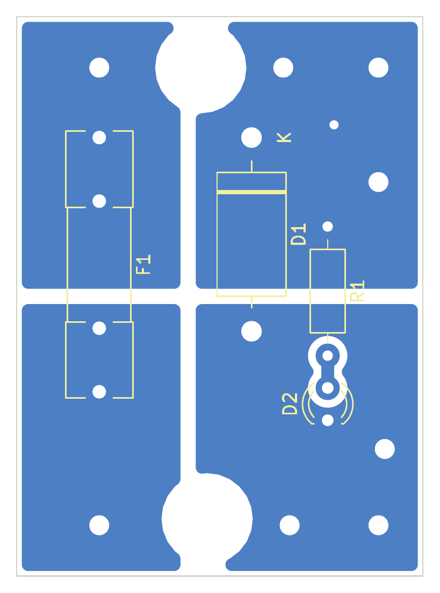
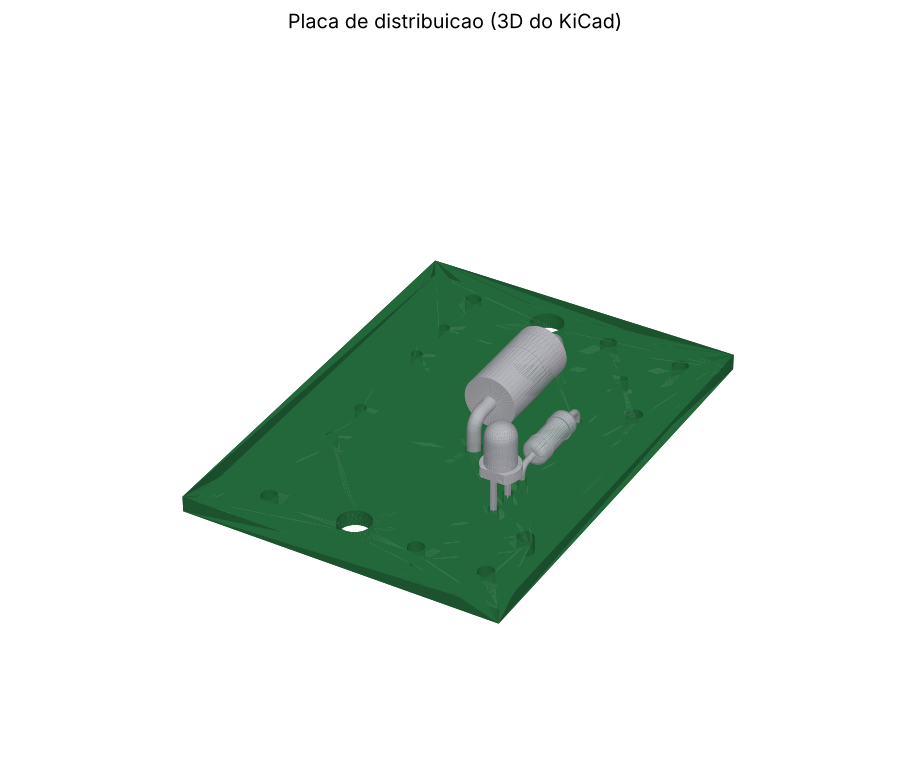
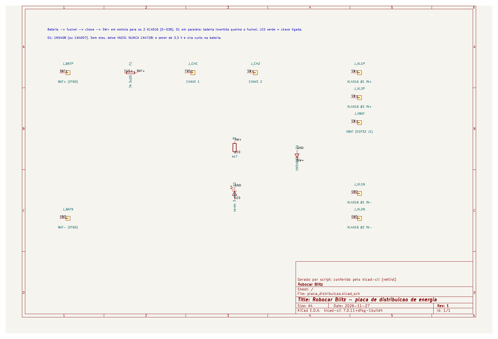

# Placa de distribuição de energia (fusível, chave e saídas), 32 × 44 mm, face simples

Substitui a placa improvisada de cobre dividido. É a **mesma ideia** (cobre grande, fios soldados direto no cobre),
mas com 4 ilhas na ordem certa, um diodo de proteção e um LED de "chave ligada". Fica no **andar 2**, atrás da Jetson,
entre o plugue USB e o P4, em **2 espaçadores M3 de 10 mm**. Decisão: [D-036](../../docs/decisoes.md).



**Abrir no KiCad:** Arquivo → Abrir projeto → `hardware/placa_distribuicao/placa_distribuicao.kicad_pro`. Na janela
do projeto: esquemático (`placa_distribuicao.kicad_sch`) e placa (`placa_distribuicao.kicad_pcb`); na placa, **Alt+3**
abre o 3D. Abre no KiCad 7 a 10. O 3D também está em `placa_distribuicao.step` (abre no Onshape/FreeCAD). O
esquemático é conferido pelo próprio KiCad contra o circuito e contra a placa a cada `make placa-distribuicao`.





## Circuito

```
 XT60 (bateria) ── BAT+ ──[ F1 7 A ]── FUS+ ── fio ──► chave KCD1 (terminal 1)
                                                      chave KCD1 (terminal 2) ── fio ──► SW+
 SW+ ──► XL4016 #1 (Jetson)      um par de fios só para ele
     ──► XL4016 #2 (motores)     um par de fios só para ele
     ──► VBAT (fio fino até o J1 da placa da ESP32: medir a bateria)
     ──► R1 4,7 kΩ ──► LED verde ──► GND           aceso = chave ligada (puxa ~2 mA)
     ──┤◄── D1 1N5408 ── GND                       proteção contra bateria invertida
 XT60 (bateria) ── BAT− ── GND ──► XL4016 #1 −, XL4016 #2 −
```

| Ilha | Liga em | Fica |
|---|---|---|
| **BAT+** | + da bateria (pigtail do XT60) e um lado do fusível | trás, lado direito |
| **FUS+** | outro lado do fusível e o fio para o terminal 1 da chave | trás, lado esquerdo (perto da chave) |
| **SW+** | fio que volta do terminal 2 da chave; saídas XL1+, XL2+, VBAT; LED; catodo do D1 | frente, lado esquerdo |
| **GND** | − da bateria; XL1−, XL2−; LED; anodo do D1 | frente, lado direito |

## Por que assim (decisões)

| Pergunta | Decisão | Por quê |
|---|---|---|
| Ordem | **bateria → fusível → chave → conversores** | o fusível protege tudo a partir da bateria, inclusive o fio da chave. A placa improvisada não deixava claro onde a chave entrava |
| Como alimentar os 2 XL4016 | **um par de fios para cada um**, saindo da placa (em estrela) | antes o #2 pegava energia no borne do #1 (2 fios por borne). Com isso a corrente dos motores passava pelo borne e pelo fio da Jetson: quando os motores arrancavam, a entrada da Jetson também caía. Em estrela, cada um tem o seu fio |
| VBAT | **sai da placa** (ilha SW+), não emendado no terminal da chave | menos emenda; mede a bateria depois da chave, como antes |
| Diodo de proteção | **D1 em paralelo (catodo no SW+)**, não em série | em série, ele perderia ~0,5 V e esquentaria o tempo todo. Em paralelo, não faz nada no uso normal. Com a bateria invertida, ele conduz e **queima o fusível** antes de algo estragar (o XT60 já não encaixa invertido; isso cobre um pigtail soldado trocado ou uma fonte de bancada ligada ao contrário). Use **1N5408** (aguenta o pico até o fusível abrir); sem ele, 1N4007 é a segunda opção (pode abrir antes do fusível; aí só não protege) |
| LED verde | **aceso = chave ligada** | a Jetson desligada não mostra nada, e a bateria ligada com a chave esquecida em ON descarrega a LiPo abaixo do limite. O LED denuncia |
| Cobre | 4 ilhas grandes, **≥ 3 mm de largura em todo caminho** de corrente, pinos ligados **direto** (sem alívio térmico) | 7 A (fusível) em cobre de 35 µm pede ~2,5 mm (IPC-2221); 3 mm dá margem para a corrosão caseira. Ligação direta = mais corrente, como na placa improvisada (precisa de ferro de 40 W ou mais) |
| Sem letras no cobre | os nomes ficam na **folha de montagem** | letras de cobre partiam as ilhas no meio |
| Fixação | **2 parafusos M3 + espaçadores de 10 mm** | os fios são soldados por baixo: precisam de espaço até o MDF. Os furos ficam no vão entre as ilhas, com 3,6 mm sem cobre em volta (o parafuso não encosta em nenhuma ilha) |

## Peças (todas da lista de compras, exceto D1, LED e R1, do laboratório)

> **NUNCA use 1N4728 no D1.** O 1N4728 é um **zener de 3,3 V**, não um diodo retificador. No lugar do D1 ele
> conduz com qualquer tensão acima de 3,3 V: com a bateria (11–12,6 V) vira um **curto**, e o fusível queima (ou o
> zener esquenta até estourar) assim que a chave liga. Sem 1N5408 ou 1N400x, deixe o D1 vazio: a placa funciona igual,
> só sem a proteção contra bateria invertida (o XT60 já não encaixa ao contrário).

| Ref | Peça | Item da lista |
|---|---|---|
| F1 | fusível de vidro **5 × 20 mm 7 A** + 2 **terminais porta-fusível 5 × 20** (clipes para soldar) | 14 e 15 |
| — | chave gangorra **KCD1-101 2T** (na parede do berço da bateria, não na placa) | 16 |
| D1 | diodo **1N5408** (ou 1N4007; ver acima). **Sem eles, deixe o D1 vazio.** | laboratório / ~R$ 0,50 |
| D2 | LED verde 3 mm | laboratório |
| R1 | resistor 4,7 kΩ (3,3k a 10k servem) | laboratório |
| — | cabinho 0,75 mm² vermelho e preto | 19 e 20 |
| — | 2 espaçadores M3 de 10 mm + 2 parafusos M3 × 16 + porcas | 23 |
| — | placa de fenolite face simples, 32 × 44 mm (sobra da placa da ESP32) | — |

**Antes de corroer:** imprima `fabricacao/1_cobre_transferencia_1x1.pdf` em 100 % (sem "ajustar à página"), meça a
largura da placa no papel com régua (**32,0 mm**) e ponha os 2 clipes do fusível em cima do desenho. Os furos dos
clipes estão para clipes com pinos externos a **20 mm** (Littelfuse 111). Se os seus forem diferentes, me passem a
medida.

## Fazer

1. Corrosão: igual à placa da ESP32 (`1_cobre_transferencia_1x1.pdf`, preto = cobre, marca no centro de cada furo).
2. Furos: fios grossos 1,5 mm; clipes do fusível e D1 1,0–1,3 mm (confira na peça); R1, LED e VBAT 0,8–1,0 mm;
   fixação 3,2 mm. Mapa em `fabricacao/*.drl`.
3. Montagem pela [folha de montagem](fabricacao/2_montagem.pdf): clipes do fusível, D1 (**faixa no lado do SW+**),
   R1, LED (**perna longa no furo de cima, que vai ao R1**), fios por último.
4. **Antes de pôr a bateria**, multímetro em continuidade:
   * BAT+, FUS+, SW+ e GND **sem continuidade entre si** (sem o fusível);
   * com o fusível: BAT+ ↔ FUS+ em continuidade;
   * chave ligada: FUS+ ↔ SW+ em continuidade; desligada: aberto.
5. Bateria, chave desligada: LED apagado, 0 V nos XL4016. Chave ligada: LED aceso, tensão da bateria nos 2 XL4016.

## Fios (comprimentos de corte do modelo do chassi; ver `mecanica/chassi_v4/verificacao.md`)

| Fio | De → para | Corte |
|---|---|---|
| pigtail (vermelho + preto) | XT60 do chassi → BAT+ / BAT− | 132 mm |
| vermelho | CHAVE 1 → terminal 1 da chave | 92 mm |
| vermelho | terminal 2 da chave → CHAVE 2 | 93 mm |
| par | XL1 + / XL1 − → IN do XL4016 #1 (Jetson) | 151 mm |
| par | XL2 + / XL2 − → IN do XL4016 #2 (motores) | 145 mm |
| fino | VBAT → J1 da placa da ESP32 | 177 mm (Dupont de 1 via no meio, para tirar o andar 3) |

Os pares dos XL4016 descem pelo passa-fio novo na frente da placa (andar 2) e passam por cima dos motores.

## Gerar de novo

```bash
make placa-distribuicao
```

Roda `placa.py` (Python do KiCad): monta a placa, roda o DRC (cobre, furos, bordas, corpos, ligações), confere pino a
pino contra o circuito, confere que só há cobre embaixo e que todo caminho de corrente tem ≥ 3 mm, e grava o
`.kicad_pcb`, os PDFs 1:1, a furação e as imagens. `python3 placa.py --negativos` planta 8 defeitos (um deles, um esquemático com o diodo invertido) e confere
que cada um é pego.
