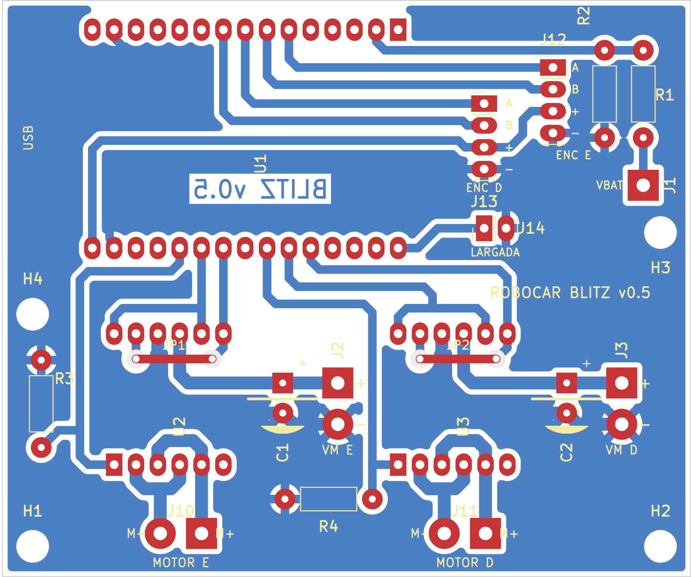
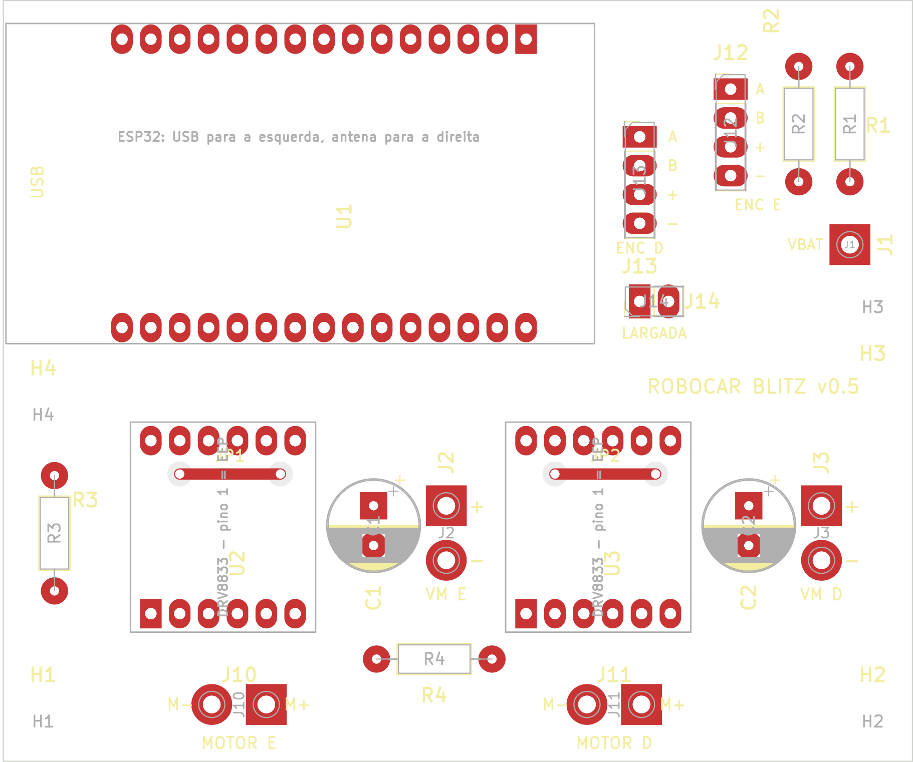

# Robocar Blitz — placa da ESP32, v0.5 (enxuta, embaixo da Jetson)

Placa pequena que fica no **1º andar do carro, embaixo da Jetson**. Só tem o que precisa estar junto da ESP32:
os dois DRV8833 (um por motor, em paralelo), os pontos de solda dos fios dos motores e dos encoders, o divisor da
bateria e a largada. Fusível, chave, XT60 e os dois XL4016 ficam **fora**, no chicote de energia (ver "Fora da placa").

* **80 × 67 mm**, face simples, PTH, para **corrosão manual**: trilha mínima de **1,0 mm**, folga de 0,5 mm, ilhas grandes.
* **2 jumpers** de fio, ambos escondidos embaixo dos DRV8833 (são inevitáveis no modo paralelo, ver "Jumpers").
* Só peças que já temos (lista de compras + laboratório). **Nada novo para comprar.**
* Motores em **7,2 V** (XL4016 #2) e encoders em **3,3 V** direto na ESP32.

| v0.4 (anterior) | **v0.5 (esta)** |
|---|---|
| 103 × 95 mm, tudo na placa (fusível, chave, conversores, CD4050, 78L05, buzzer) | **80 × 67 mm**, só ESP32 + drivers + pontos de fio |
| 11 jumpers | **2 jumpers** (ambos embaixo dos módulos) |
| encoders em 5 V com CD4050B e 78L05 | encoders em **3,3 V** direto ([D-018](../../docs/decisoes.md)) |
| motores em 6,0 V | motores em **7,2 V** ([D-019](../../docs/decisoes.md)) |
| um GPIO no nSLEEP dos dois drivers | um GPIO por driver, com pull-down de 10k ([D-020](../../docs/decisoes.md)) |

## O que tem aqui

| Arquivo | Conteúdo |
|---|---|
| `placa_esp32.kicad_pro` / `.kicad_sch` / `.kicad_pcb` | Projeto KiCad (abre no KiCad 10; os arquivos estão no formato do KiCad 7, o KiCad 10 converte ao salvar) |
| `placa_esp32.pdf` | Esquemático em PDF |
| `fabricacao/1_cobre_transferencia_1x1.pdf` | **Arte do cobre**, 1:1 numa folha A4, preto = cobre, com marca de centro nas ilhas |
| `fabricacao/2_montagem_e_jumpers.pdf` | Lado dos componentes: peças, referências e os 2 jumpers (vermelho) |
| `fabricacao/placa_esp32-PTH.drl`, `-NPTH.drl` e `*-drl_map.pdf` | Furação (Excellon) e mapa de brocas |
| `fabricacao/BOM.csv` | Peças da placa, com posição e origem |
| `imagens/` | Cobre visto de cima, lado do cobre (como fica na placa) e folha de montagem |
| `verificacao/` | DRC, conferência esquema × placa, ângulos/larguras e lista dos jumpers |
| `lib/robocar_sm.pretty` | Pegadas `_SoldaManual` (ilha maior, furo e passo originais) |
| `lib/robocar.kicad_sym`, `lib/robocar.3dshapes` | Símbolos e 3D da ESP32 DevKit V1 e do DRV8833 |

## O que fica na placa e o que fica fora

A regra foi: **na placa, só o que liga na ESP32 ou nos drivers.** O resto é fio.

| Na placa | No chicote (fora da placa) |
|---|---|
| ESP32 DevKit V1 em barras fêmea (alimentada pelo **USB da Jetson**) | XT60 → **fusível 7 A** → **chave** → XL4016 #1 (5,2 V, Jetson) e XL4016 #2 (7,2 V, motores) |
| 2 DRV8833 em barras fêmea, com 470 µF cada | Os 2 clips de porta-fusível 5×20 comprados vão numa **plaquinha perfurada** (laboratório) junto da chave e do XT60 |
| Pontos de solda: VM (2 pares), motores, encoders, VBAT, largada | O fio do VBAT sai **depois da chave** e vem até o J1 |
| Divisor 150k/33k da bateria, pull-downs de 10k do nSLEEP | |

Por que assim: os XL4016 (65 × 46 mm cada) e a bateria ficam perto do eixo traseiro (ver o layout do carro); a placa da
ESP32 fica embaixo da Jetson. Levar a bateria até esta placa só para voltar aos conversores era fio e trilha larga à toa.

## Ideia do desenho

* **ESP32 girada com o USB para a borda esquerda** (o cabo vai para a Jetson) e a antena para a direita.
  * A **fileira de baixo** da ESP32 (GPIO23 … 3V3) desce direto para os DRV8833: cada GPIO cai em cima do pino que ele aciona.
  * A **fileira de cima** (GPIO36, 32, 33, 25, 26) passa **por baixo da ESP32**, entre as barras fêmea (ela fica elevada), e sai
    pela direita, no bloco dos encoders e do divisor. O 3V3 também passa por esse corredor, por baixo dos outros, e por isso
    chega nos dois conectores de encoder sem cruzar nada.
* **Drivers embaixo**, lado a lado, com as entradas para cima (perto da ESP32) e as saídas para baixo (perto dos motores, que
  ficam no eixo traseiro). O VM e o GND de cada driver saem **por dentro do módulo** (entre as fileiras) até o 470 µF e os fios
  do XL4016 dele (J2 e J3).
* **Motores na borda de baixo** (J10, J11), **encoders no canto de cima à direita** (J12, J13, mesma ordem nos dois: A, B, +, −).
* **Plano de GND** em todo o cobre livre (folga 0,6 mm, alívio térmico com raios de 1 mm). Nenhuma ilha de GND solta.

### Pinagem da ESP32 (igual ao [config.h](../../firmware/robocar_esp32/config.h))

| GPIO | Pino da DevKit | Função | Vai para |
|---|---|---|---|
| 16 (RX2) | 25 | motor esquerdo IN1 | IN2+IN4 do U2 (ponte espelhada, [D-013](../../docs/decisoes.md)) |
| 17 (TX2) | 24 | motor esquerdo IN2 | IN1+IN3 do U2 (IN3 pelo JP1) |
| 19 | 21 | motor direito IN1 | IN2+IN4 do U3 |
| 21 | 20 | motor direito IN2 | IN1+IN3 do U3 (IN3 pelo JP2) |
| 4 | 26 | nSLEEP do driver esquerdo | EEP do U2; R3 10k para o GND |
| 18 | 22 | nSLEEP do driver direito | EEP do U3; R4 10k para o GND |
| 32 / 33 | 6 / 7 | encoder esquerdo A / B | J12 |
| 25 / 26 | 8 / 9 | encoder direito A / B | J13 |
| 36 (VP) | 2 | bateria (ADC1) | divisor R1 150k / R2 33k |
| 23 | 16 | largada | J14 (jumper para o GND) |
| 2 | 27 | LED | LED da própria DevKit (sem trilha) |
| 3V3 / GND | 30 / 14 e 29 | alimentação dos encoders / plano de GND | J12, J13 |

Pinos evitados de propósito: 0, 2, 5, 12 e 15 (strapping do boot), 1 e 3 (USB serial), 14 (PWM no boot), 39 (falsas
interrupções quando o ADC é usado). Os drivers dormem (EEP em nível baixo pelo pull-down) até o firmware armar, então
o boot da ESP32 não mexe os motores.

## Ligações (fios)

| Ponto | Fio | De onde |
|---|---|---|
| J2 `+ −` | cabinho 0,75 mm² vermelho/preto | saída do **XL4016 #2 (7,2 V)** — 1º par |
| J3 `+ −` | cabinho 0,75 mm² vermelho/preto | saída do XL4016 #2 — 2º par (os dois pares no mesmo borne) |
| J10 `M+ M−` | vermelho (M+), branco (M−) | motor esquerdo |
| J11 `M+ M−` | vermelho (M+), branco (M−) | motor direito |
| J12 `A B + −` | amarelo, verde, preto, azul | encoder do motor esquerdo |
| J13 `A B + −` | amarelo, verde, preto, azul | encoder do motor direito |
| J1 `VBAT` | fio fino | + da bateria **depois da chave** |
| J14 | 2 pinos macho + jumper (ou um botão em 2 fios) | colocar o jumper = apertar o botão de largada |
| USB da ESP32 | cabo de dados | Jetson (alimenta a ESP32) |

Cores do cabo da RoboCore (pinagem da loja): 1 vermelho M+, 2 branco M−, 3 amarelo A, 4 verde B, 5 preto + do encoder,
6 azul − do encoder. **Confira com o multímetro** antes de soldar (o sentido de giro se acerta depois em `INVERTER_E/D`).
Se o cabo vier com conector na ponta, corte o conector e solde os fios nos pontos.

## Regras usadas

| Item | Valor |
|---|---|
| Trilha de sinal (mínima) | **1,0 mm** |
| Motores, VM e GND dos drivers | 1,5 mm (≈ 3,2 A em 35 µm com +10 °C pela IPC-2221; o pico é ≈ 1,9 A por motor) |
| Folga cobre–cobre | 0,5 mm |
| Folga do plano de GND | 0,6 mm; alívio térmico com raios de 1,0 mm |
| Cobre até a borda | 0,6 mm |
| Ângulos | só 0°, 45° e 90°; toda curva é chanfrada a 45°; nenhum encontro agudo |

**Ilhas (furo → ilha)** — o furo e o passo da peça não mudaram:

| Peça | Furo | Ilha |
|---|---|---|
| Resistores, eletrolíticos 470 µF | 0,8 mm | 2,4 mm |
| Barras fêmea da ESP32 e dos DRV8833 | 1,0 mm | 2,6 × 1,9 mm (oval, quadrada no pino 1) |
| Fios dos encoders e largada (J12, J13, J14) | 1,0 mm | 3,0 × 1,9 mm |
| Fios 0,75 mm² e dos motores (J1, J2, J3, J10, J11) | 1,55 mm | 3,6 mm |
| Furos dos jumpers JP1, JP2 | 0,8 mm | 2,2 mm |

**Polaridade:** ilha **quadrada = pino 1**: + do eletrolítico, EN da ESP32 (canto de cima à direita), EEP dos DRV8833
(canto de baixo à esquerda de cada módulo), M+ dos motores, + do VM, A dos encoders.

## Jumpers (2)

No modo paralelo é preciso ligar IN1 com IN3 e IN2 com IN4. Na fileira do módulo a ordem é IN4, IN3, GND, VCC, IN2, IN1:
os dois pares se intercalam e o GND e o VCC ficam no meio, então **um dos pares sempre precisa de um jumper** (o outro
passa por fora, pela trilha em U em cima do módulo). O jumper fica **embaixo do módulo**, que encaixa por cima.

Coordenadas em mm a partir do **canto superior esquerdo da placa, vista de cima** (a folha de montagem):

| # | Rede | De | Até | Compr. | Fio |
|---|---|---|---|---|---|
| JP1 | ME_IN2 (IN1+IN3 do driver esquerdo) | (15,5; 41,7) | (24,4; 41,7) | 9 mm | rígido 0,5–0,6 mm, deitado na placa |
| JP2 | MD_IN2 (IN1+IN3 do driver direito) | (48,5; 41,7) | (57,4; 41,7) | 9 mm | idem |

Solde os jumpers **antes** das barras fêmea.

## Fabricação caseira (transferência térmica)

1. **Imprimir** `fabricacao/1_cobre_transferencia_1x1.pdf` em impressora **laser**, escala **100 %** (sem "ajustar à
   página"). Conferir com régua: a placa tem **80 × 67 mm**.
2. **Conferir a orientação.** Na folha, o texto "BLITZ v0.5" aparece **espelhado**. Depois de transferido, ele fica
   **legível** olhando o lado do cobre (`imagens/lado_do_cobre.png`). Se não ficar legível, a placa saiu espelhada e a
   ESP32 entraria invertida.
3. **Transferir, corroer e limpar.** As marquinhas no centro das ilhas guiam a broca.
4. **Furar** (mapa: `placa_esp32-PTH-drl_map.pdf`):

| Broca | Onde |
|---|---|
| 0,8 mm | resistores, eletrolíticos, furos dos jumpers |
| 1,0 mm | barras fêmea, J12, J13, J14 |
| 1,5–1,6 mm | pontos dos fios grossos (J1, J2, J3, J10, J11) |
| 3,2 mm | 4 furos de fixação M3 |

5. **Montar:** JP1 e JP2 → resistores → barras fêmea (2 × 1x15 para a ESP32, 4 × 1x6 para os DRV8833) → 470 µF (atenção
   ao +) → pinos do J14 → fios.
6. **Antes de encaixar a ESP32 e os módulos:**
   - procurar curto entre +3V3, VM_E, VM_D e GND (multímetro em continuidade);
   - ligar só o XL4016 #2 (já ajustado em 7,2 V sem carga) e medir 7,2 V entre os furos VCC e GND de cada soquete de DRV8833;
   - com a bateria ligada, medir no furo do GPIO36 (pino 2 do soquete da ESP32): ≈ VBAT × 0,18 (2,27 V com 12,6 V);
   - seguir os testes T05–T07 de [docs/06_testes.md](../../docs/06_testes.md).

## Peças

Tudo já comprado ou do laboratório (`fabricacao/BOM.csv` tem a lista com posições):

| Peça | Qtd | Origem |
|---|---|---|
| ESP32 DevKit V1 (30 pinos) | 1 | já temos |
| Módulo DRV8833 | 2 (+1 reserva) | Smart Kits |
| Eletrolítico 470 µF 16 V (8 mm, passo 3,5) | 2 (+2 reserva) | Smart Kits |
| Resistores 1/4 W: 150k, 33k, 10k ×2 | 4 | laboratório |
| Barra fêmea 2,54 mm: 1x15 ×2 e 1x6 ×4 (cortar de 1x40) | — | já temos |
| Barra de pinos macho 1x2 + jumper | 1 | um dos jumpers do pacote do J48 da Jetson serve |
| Cabinho 0,75 mm² vermelho e preto | ~40 cm | Smart Kits |
| Fio rígido 0,5–0,6 mm | ~2 cm | JP1 e JP2 (pode ser perna cortada de resistor) |
| Espaçadores e parafusos M3 | 4 | laboratório |
| Placa de fenolite (ou fibra) **face simples**, ≥ 85 × 70 mm, percloreto e papel de transferência | 1 | laboratório (se não tiver, é a única compra) |

Sobram da lista da v0.4 (não usados aqui): CD4050B, soquete DIP-16, 78L05, BC337, 1N4148, buzzer, chave táctil, KF2510.
A chave táctil pode ir em 2 fios no J14, no lugar do jumper.

## Medir antes de fabricar

| Item | O que medir | Valor usado |
|---|---|---|
| ESP32 DevKit V1 | distância entre as fileiras (centro a centro) e os nomes na serigrafia (EN no canto, 3V3 do outro lado) | 25,40 mm (desenho DOIT) |
| Módulo DRV8833 | distância entre as fileiras e a ordem dos pinos | 15,24 mm **estimado**; EEP, OUT1–4, ULT / IN4, IN3, GND, VCC, IN2, IN1 |
| Módulo DRV8833 | resistência entre EEP e VCC (jumper de solda ou resistor de pull-up do módulo) | **sem ligação direta**. Se o módulo tiver um pull-up de 47k para o VCC, o pull-down de 10k da placa segura o EEP em ≈ 1,3 V no boot (seguro para a ESP32); se der ~0 Ω (jumper de solda fechado), abrir o jumper |
| 470 µF | diâmetro e passo | 8 mm, 3,5 mm |
| Encoder (quando os motores chegarem) | ligar em 3,3 V e girar a roda à mão: A e B têm de ir de 0 a 3,3 V | ver T06 |

Se algo mudar, edite a pegada em `lib/robocar_sm.pretty`, atualize a placa a partir do esquemático e refaça só as
trilhas daquela peça, rodando o DRC de novo.

## Verificações

| O quê | Resultado | Arquivo |
|---|---|---|
| DRC (KiCad) | 0 violações de cobre, 0 ligações faltando; só avisos de serigrafia cortada pela máscara e da biblioteca MountingHole (nativa do KiCad) | `verificacao/drc.rpt` |
| Esquema × placa | mesmas 17 peças, mesmas pegadas e mesmas ligações em todos os pinos (21 redes) | `verificacao/paridade_esquema_placa.txt` |
| Ângulos e larguras | 117 trechos, todos a 0/45/90°; nenhuma curva fechada; trilha mais fina 1,00 mm | `verificacao/angulos_e_larguras.txt` |
| Firmware | `config.h` com esta pinagem; checagem de sintaxe C++ OK (falta compilar no Arduino IDE e gravar) | [firmware/](../../firmware/) |

O ERC do esquemático deve ser rodado no KiCad 10 (o kicad-cli usado aqui, versão 7, não tem ERC).

## Fontes

* TI, DRV8833 (datasheet): VM 2,7–10,8 V; modo paralelo ligando AIN1/BIN1, AIN2/BIN2, AOUT1/BOUT1 e AOUT2/BOUT2;
  nSLEEP com pull-down interno. <https://www.ti.com/lit/ds/symlink/drv8833.pdf>
* Pinagem e esquema do módulo DRV8833: Components101 <https://components101.com/modules/drv8833-dual-h-bridge-motor-driver-module>
  e CircuitDigest <https://circuitdigest.com/microcontroller-projects/interface-drv8833-dual-motor-driver-module-with-arduino>;
  medidas do módulo: Smart Kits <https://www.smartkits.com.br/modulo-ponte-h-dupla-drv8833-2a>.
* Motor N20 6 V 750 rpm com encoder (pinagem do cabo, corrente de stall 1,6 A em 6 V):
  RoboCore <https://www.robocore.net/motor-caixas-de-reducao/micro-motor-caixa-de-reducao-6v-750rpm-com-encoder>.
* ESP32: pinos de strapping e GPIOs só de entrada — Espressif, *ESP32 Series Datasheet* e guia de GPIO do ESP-IDF
  <https://docs.espressif.com/projects/esp-idf/en/stable/esp32/api-reference/peripherals/gpio.html>.
* Largura de trilha × corrente: IPC-2221 (calculadora de qualquer fabricante de PCB).
