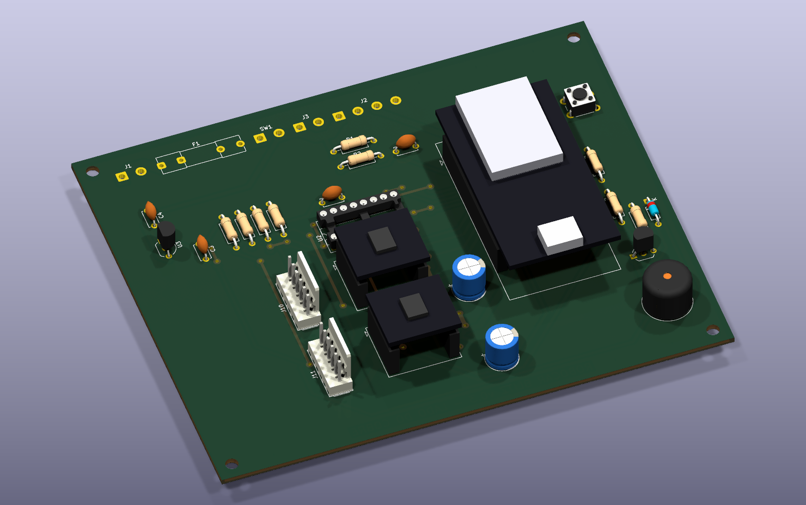

# hardware/placa_esp32/

Placa-base da ESP32: bateria, fusível, chave, conversores, os dois DRV8833, os dois motores com encoder, conversão de nível dos encoders, botão de largada e buzzer. **Face simples** (cobre só embaixo), componentes PTH, para corrosão caseira.

A ESP32 e os DRV8833 **encaixam** em barras de pinos fêmea. Os XL4016, a bateria e a chave ligam por fio soldado.



| Arquivo | Conteúdo |
|---|---|
| `placa_esp32.kicad_pro` | Projeto KiCad 10: abra este no KiCad |
| `placa_esp32.kicad_sch` | Esquemático (fonte da verdade das ligações) |
| `placa_esp32.kicad_pcb` | Placa: posicionamento, trilhas, plano de GND, jumpers |
| `placa_esp32.pdf` | Esquemático em PDF |
| `placa_esp32_3d.png` | Vista 3D |
| `fabricacao/1_cobre_transferencia_1x1.pdf` | **Arte do cobre** para transferência térmica, escala 1:1, preto = cobre |
| `fabricacao/2_montagem_e_jumpers.pdf` | Lado dos componentes: posição das peças e dos jumpers (em vermelho) |
| `fabricacao/placa_esp32.drl` e `placa_esp32-drl_map.pdf` | Furação (arquivo Excellon e mapa de brocas) |
| `lib/` | Símbolo, footprint e 3D da ESP32 DevKit V1 e do módulo DRV8833 (não existem no KiCad) |
| `sym-lib-table`, `fp-lib-table` | Apontam o KiCad para `lib/` |

## Estado (14/11/2026)
| Verificação | Resultado |
|---|---|
| ERC do esquemático (`kicad-cli`, todas as severidades) | **0 violações** [V] |
| Ligações × firmware | os 12 sinais têm o mesmo GPIO no esquemático e no [config.h](../../firmware/robocar_esp32/config.h). Nenhum GPIO proibido ou a evitar [V] |
| Ligações × versão anterior | conferidas rede por rede. As únicas diferenças são as três mudanças intencionais descritas abaixo [V] |
| DRC da placa (todas as severidades, com paridade com o esquemático) | **0 violações, 0 ligações faltando, 0 diferenças com o esquemático** [V] |
| Fabricada, montada ou testada | **não** [T] |

Para conferir de novo:
```bash
K=~/Applications/KiCad/kicad-10.0.6-x86_64.AppImage
cd hardware/placa_esp32
$K kicad-cli sch erc --severity-all placa_esp32.kicad_sch
$K kicad-cli pcb drc --schematic-parity --severity-all placa_esp32.kicad_pcb
```

## Esquemático
Está numa folha só, dividida em quatro blocos ligados por fios:
1. **Alimentação.** Bateria → fusível → chave → barramento VBAT_SW, que alimenta os dois XL4016, o divisor da bateria e o 78L05 dos encoders.
2. **Encoders.** Pull-ups de 5 V e o CD4050B, que converte 5 V em 3,3 V.
3. **ESP32**, com o botão de largada, o pull-down do sleep e o driver do buzzer.
4. **Motores.** Os dois DRV8833 em modo paralelo e os conectores dos motores.

Rótulos com o mesmo nome (`ENC_E_A_5V`, `DRV_SLEEP`, `VBAT_ADC`) são o mesmo fio. Eles só aparecem onde um fio direto atravessaria a folha.

**Mudanças desta versão** (todas mantêm o comportamento elétrico):
* **Ponte espelhada no DRV8833.** `ME_IN1` vai em IN2+IN4 do módulo, `ME_IN2` em IN1+IN3, e o M+ do conector sai de OUT2+OUT4; o mesmo vale para o motor direito. Pela tabela-verdade do DRV8833, IN1=1/IN2=0 dá OUT1 alto, e trocar entradas e saídas juntas é só renomear a ponte: "para frente" continua sendo M+ positivo. Nenhum GPIO mudou. Motivo: na fileira do módulo, IN4/IN2 estão acima de IN3/IN1, e assim as linhas da ESP32 chegam sem se cruzar ([D-013](../../docs/decisoes.md)).
* **Canais do CD4050B.** Os canais foram escolhidos pela posição na placa: ENC_D_A em F (14→15), ENC_D_B em E (11→12), ENC_E_A em C (7→6) e ENC_E_B em B (5→4). Nas unidades sem uso, a entrada A vai ao +3V3 e a D ao GND. A TI manda ligar entradas CMOS sem uso a VDD ou VSS.
* **78L05 e BC337** usam o TO-92 com pernas a 2,54 mm (`TO-92_Inline_Wide`). No TO-92 comum (1,27 mm) sobram só 0,2 mm entre as ilhas, pouco para corrosão caseira.

## Pinos da ESP32
A fonte única dos pinos é o [config.h](../../firmware/robocar_esp32/config.h). Mudou um pino? Mude o `config.h`, o esquemático, a placa e a tabela de [docs/03_hardware.md](../../docs/03_hardware.md#6-pinagem-da-esp32) juntos. Cada escolha foi conferida no [datasheet do ESP32](https://documentation.espressif.com/esp32_datasheet_en.pdf) e no [esquema da DOIT DevKit V1](https://mischianti.org/wp-content/uploads/2024/11/DOIT-ESP32-DevKit-V1-schematics.pdf).

| Sinal | GPIO | Por que este pino é seguro |
|---|---|---|
| ME_IN1 / ME_IN2 | 25 / 26 | Saída comum. Não é pino de boot nem de flash, e a DevKit não tem nada ligado nele |
| MD_IN1 / MD_IN2 | 27 / 13 | Idem. O 13 substitui o 14, que emite sinal no boot |
| DRV_SLEEP | 18 | Saída comum. R3 (100k para o GND) mantém os drivers desligados durante o reset; os IN do DRV8833 também têm pull-down interno |
| Encoder esq. A/B | 32 / 33 | Entrada com interrupção. O cristal de 32 kHz que usaria estes pinos não existe na DevKit |
| Encoder dir. A/B | 34 / 35 | Só entrada e sem pull-up interno, o que basta: o CD4050B entrega 0/3,3 V push-pull |
| VBAT_ADC | 36 | ADC1, que funciona com Wi-Fi ligado. Usado só como ADC, sem interrupção |
| BOTAO | 23 | Entrada com pull-up interno, botão para o GND |
| BUZZER | 4 | Não é pino de boot. Aciona o BC337 por 1k |
| LED / serial da Jetson | 2 / 1 e 3 | Já na própria DevKit, sem trilha nesta placa |

**Pinos evitados:**
- **GPIO 6–11:** são do flash.
- **GPIO 0, 2, 5, 12 e 15:** são de boot (*strapping*). O 12 define a tensão do flash.
- **GPIO 14:** emite sinal no boot.
- **VIN:** fica sem ligação, porque a ESP32 é alimentada pelo USB.

**Níveis lógicos** (datasheets):
| Ligação | Exigido | Entregue |
|---|---|---|
| ESP32 → DRV8833 IN | ≥ 2 V | ≥ 2,64 V |
| ESP32 → DRV8833 nSLEEP | ≥ 2,5 V | ≥ 2,64 V; na prática ~3,3 V, com carga de 100k |
| CD4050B → ESP32 | ≥ 2,48 V / ≤ 0,83 V | 0 / 3,3 V |
| Encoder → CD4050B | entrada pode passar do VCC ([TI](https://www.ti.com/lit/ds/symlink/cd4050b.pdf)) | 0 / 5 V |

## Encoder: 5 V + CD4050B
A RoboCore **não publica** a tensão do encoder. O único dado dela é a [medição no osciloscópio](https://d229kd5ey79jzj.cloudfront.net/3081/osciloscopio.png): 5,28 Vpp, ou seja, alimentado em ~5 V. Encoders N20 Hall com ficha técnica aceitam 3,3 ou 5 V e saem com nível igual à alimentação: [Waveshare](https://www.waveshare.com/dcgm-n20-12v-en-200rpm.htm) e [ficha BJ-N20 (SparkFun)](https://cdn.sparkfun.com/assets/a/3/9/9/9/28633_datasheet_N20_Motor_With_Encoder_and_Cable_pair.pdf).

Por isso a placa alimenta o encoder com 5 V (78L05) e converte A/B para 3,3 V com o CD4050B. **O encoder trabalha na condição que a loja testou, e a ESP32 nunca recebe mais que 3,3 V.** Um divisor resistivo foi descartado: o pull-up interno do encoder é desconhecido e poderia derrubar o nível alto. Decisão D-011.

Conector do motor, na ordem da [pinagem RoboCore](https://d229kd5ey79jzj.cloudfront.net/3081/pinagem.png): 1 M+, 2 M−, 3 A, 4 B, 5 Vcc, 6 GND. Use o número do pino, porque as cores na figura da loja se contradizem. Na placa, o conector é um **KF2510 (Molex KK 2,54 mm) de 6 vias**.

## Placa (PCB)
* **Tamanho e montagem:** 130 × 105 mm, 4 furos M3. Cobre embaixo (camada B.Cu); componentes em cima.
* **Plano de GND:** cobre preenchido no GND, ligado direto às ilhas, sem alívio térmico. É mais robusto em placa caseira, mas a solda nessas ilhas pede mais calor.
* **Regras usadas no DRC:**

| Classe | Redes | Trilha | Folga |
|---|---|---|---|
| Bateria | VBAT_IN, VBAT_FUS, VBAT_SW | 2,5 mm (0,8–1,0 mm só nos ramos para o divisor, C4 e 78L05) | 0,5 mm |
| Motor | +6V_MOT, ME_M1/2, MD_M1/2 | 1,5 mm (1,0 mm até C2/C3) | 0,4 mm |
| GND | GND | 1,2 mm (0,8–1,0 mm perto de ilhas pequenas) + plano | 0,4 mm |
| Sinais | demais | 0,7 mm | 0,4 mm |

Distância do cobre à borda: 1,0 mm. Furo de jumper: ilha de 1,8 mm, furo de 0,8 mm.
* **Larguras de potência [E]:** pela IPC-2221 (cobre suposto de 35 µm, aquecimento de 10 °C), 2,5 mm aguentam ~4,3 A e 1,5 mm aguentam 2 × 1,6 A. Estanhe as trilhas de bateria e motor.
* **Roteamento:** feito por ferramenta automática minha, com folga por classe, e conferido pelo DRC do KiCad. **Vale uma revisão humana antes de corroer**; o traçado pode ser melhorado à mão no KiCad.

### Jumpers (15)
Uma placa de face simples não consegue ligar tudo sem cruzar trilhas. Parte disso é inevitável: no DRV8833 em modo paralelo, as ilhas de cada fileira alternam de rede (IN4, IN3, GND, VCC, IN2, IN1). Cada jumper é um **fio por cima da placa**, do lado dos componentes, soldado em dois furos de 0,8 mm. No KiCad eles aparecem como trilha vermelha (camada F.Cu); no `2_montagem_e_jumpers.pdf` também. Alguns passam por baixo da ESP32 ou dos DRV8833, que ficam elevados nos soquetes.

Coordenadas em mm, a partir do canto superior esquerdo da placa, vista de cima:

| # | Rede | De | Até | Compr. | Fio |
|---|---|---|---|---|---|
| JP1 | ENC_D_B | (67,5; 34,0) | (71,5; 34,0) | 4 mm | rígido 0,5–0,6 mm |
| JP2 | ENC_D_A | (53,2; 36,0) | (78,0; 36,0) | 25 mm | rígido 0,5–0,6 mm, isolado |
| JP3 | +5V_ENC | (22,2; 36,2) | (22,2; 40,5) | 4 mm | rígido 0,5–0,6 mm |
| JP4 | +3V3 | (47,8; 37,8) | (47,8; 44,8) | 7 mm | rígido 0,5–0,6 mm |
| JP5 | ENC_E_A_5V | (35,8; 40,5) | (40,0; 40,5) | 4 mm | rígido 0,5–0,6 mm |
| JP6 | ENC_D_B_5V | (45,8; 40,5) | (45,8; 63,8) | 23 mm | rígido 0,5–0,6 mm, isolado |
| JP7 | ENC_E_A | (71,5; 42,2) | (75,8; 42,2) | 4 mm | rígido 0,5–0,6 mm |
| JP8 | ENC_D_A_5V | (32,0; 44,0) | (32,0; 78,2) | 34 mm | rígido 0,5–0,6 mm, isolado |
| JP9 | GND | (70,0; 47,5) | (70,0; 56,2) | 9 mm | rígido 0,5–0,6 mm |
| JP10 | +3V3 | (54,8; 48,5) | (54,8; 80,8) | 32 mm | rígido 0,5–0,6 mm, isolado |
| JP11 | ENC_E_B | (62,8; 48,5) | (66,8; 48,5) | 4 mm | rígido 0,5–0,6 mm |
| JP12 | +6V_MOT | (68,5; 59,5) | (68,5; 69,8) | 10 mm | **cabinho 0,75 mm²** |
| JP13 | +6V_MOT | (87,5; 60,5) | (87,5; 64,8) | 4 mm | **cabinho 0,75 mm²** (passa sob a ESP32) |
| JP14 | MD_IN2 | (67,5; 75,2) | (67,5; 85,2) | 10 mm | rígido 0,5–0,6 mm |
| JP15 | +6V_MOT | (71,0; 75,5) | (71,0; 79,5) | 4 mm | **cabinho 0,75 mm²** |

Os jumpers do +6V_MOT levam a corrente dos motores: use o cabinho de 0,75 mm² da compra. Os furos de 0,8 mm são para fio rígido; para o cabinho, abra esses 6 furos com 1,2 mm.

## Fabricação caseira (transferência térmica)
1. **Imprimir** `fabricacao/1_cobre_transferencia_1x1.pdf` em impressora **laser**, escala **100%**, sem "ajustar à página". Confira com régua: a placa tem 130 × 105 mm.
2. **Conferir a orientação.** Na folha, o texto "ROBOCAR BLITZ v0.3 - LADO DO COBRE" aparece **espelhado**. Depois de transferido, ele fica **legível** olhando o lado do cobre; se não ficar, a placa sai espelhada.
3. **Transferir, corroer e limpar.** As marcas pequenas no centro das ilhas guiam a broca.
4. **Furar.** As brocas estão no mapa `placa_esp32-drl_map.pdf`:

| Broca | Onde |
|---|---|
| 0,8 mm | resistores, capacitores, diodo, TO-92, soquete DIP, furos de jumper |
| 1,0 mm | barras de pinos da ESP32 e dos DRV8833, buzzer; **KF2510 também** (o arquivo pede 1,19 mm, mas os pinos são de 0,64 mm e o furo menor deixa mais cobre em volta) |
| 1,05 / 1,1 mm | porta-fusível / botão |
| 1,6 mm | pontos de solda dos fios (bateria, chave, XL4016) |
| 3,2 mm | fixação M3 |

5. **Montar em ordem de altura:** jumpers primeiro, depois resistores, diodo, capacitores cerâmicos, soquete DIP, TO-92, botão, barras fêmea, KF2510, eletrolíticos, porta-fusível e buzzer. Por último, os fios de potência.
6. **Antes de encaixar os módulos e o CD4050B:**
   - procure curtos entre VBAT, +6V_MOT, +5V_ENC, +3V3 e GND;
   - alimente pela fonte de bancada com limite de corrente baixo;
   - meça 6,0 V nos soquetes dos DRV8833 e 5 V no 78L05;
   - siga o teste T06 de [docs/06_testes.md](../../docs/06_testes.md).

## Antes de fabricar: medir as peças
| Item | O que medir | Valor usado no projeto |
|---|---|---|
| ESP32 DevKit V1 | distância entre as fileiras, de centro a centro | 25,40 mm, do [desenho DOIT em escala real](https://mischianti.org/wp-content/uploads/2021/10/DOIT-ESP32-DevKit-v1.svg) [V no desenho] |
| Módulo DRV8833 | distância entre as fileiras e ordem dos pinos na serigrafia | 15,24 mm, **estimado pela foto** [E]; pinos pela [Components101](https://components101.com/node/2317) |
| Módulo DRV8833 | continuidade EEP–VCC (jumper J2 do módulo) | tem de estar aberto, senão o GPIO18 recebe 6 V |
| Cabo do motor | conector da ponta livre | KF2510 de 6 vias na placa |
| Porta-fusível 5×20 e 470 µF | passo dos terminais e diâmetro | 20 mm (Littelfuse 111) e 8 mm |

Se algo mudar, edite o footprint no KiCad (*Editor de Footprint* → biblioteca `robocar`), atualize a placa a partir do esquemático e refaça as trilhas afetadas.

## Biblioteca própria (`lib/`)
A ESP32 DevKit V1 de 30 pinos e o módulo DRV8833 **não existem nas bibliotecas do KiCad 10**. A biblioteca da Espressif só tem a DevKitC de 38 pinos. Todo o resto usa símbolos, footprints e 3D nativos.

`lib/` tem os símbolos, footprints e modelos 3D simplificados dessas duas peças. O 3D usa caixas com as medidas e os soquetes nativos do KiCad. Para editar, use os editores do KiCad.

**SnapEDA:** existe a [DevKit V1 da DOIT](https://www.snapeda.com/parts/ESP32-DEVKIT-V1/Do%20it/view-part/), mas o site exige login e bloqueia acesso automático. Para usar o 3D de lá, baixe com a sua conta e troque o modelo no footprint, mantendo as ilhas, que seguem a medida verificada.

## Peças fora da planilha de compras
| Peça | Qtd |
|---|---|
| CD4050B (DIP-16) + soquete DIP-16 | 1 + 1 |
| 78L05 (TO-92) e BC337 (TO-92) | 1 + 1 |
| 1N4148 | 1 |
| Buzzer ativo 5 V, 12 mm, PTH (passo 7,6 mm), opcional | 1 |
| Chave táctil 6 × 6 mm, 4 terminais, PTH (botão de largada; qualquer altura) | 1 |
| KF2510 de 6 vias (macho de placa 180° + fêmea + terminais) | 2 |
| Barra de pinos fêmea 1 × 15 e 1 × 6 (2,54 mm) | 2 e 4 |
| Resistores 1/4 W (150k, 33k, 100k, 1k, 10k × 5) e cerâmicos (100 nF × 3, 330 nF) | o laboratório fornece |
| Placa de fenolite/fibra face simples ≥ 130 × 105 mm, fio rígido para jumpers | — |

Preços não cotados.

## Limitações conhecidas
* A placa passou no DRC, mas **nada foi fabricado nem testado**.
* As trilhas de 0,7 mm com folga de 0,4 mm pedem uma transferência bem feita. Confira a arte antes de corroer.
* Quinze jumpers dão trabalho de montagem. Dá para reduzir à mão no KiCad, mas cada mudança exige rodar o DRC de novo.
* O 3D é simplificado: serve para conferir encaixe, não aparência.
