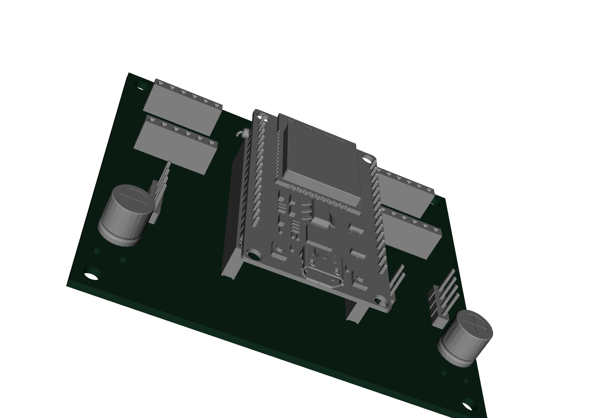

# Robocar Blitz — placa da ESP32, v0.8 (espelhada)

Placa da ESP32 com os dois drivers DRV8833. **Tudo do motor esquerdo fica na metade esquerda da placa e tudo do
motor direito na metade direita**: cada cabo de motor (6 fios) e cada par de VM chega no seu lado. Face simples
(cobre só embaixo), para **corrosão manual**.

* **80 × 73 mm** (vista de cima: borda de cima = frente do carro, borda de baixo = traseira).
* **4 furos M3 nos cantos**, a 3,5 mm das bordas (73 × 66 mm entre centros). Nenhum cobre que não seja GND a menos
  de 3,6 mm do centro de um furo (pode usar espaçador metálico).
* **ESP32 em pé, no meio, com o USB para trás** (borda de baixo) e a antena para a frente. Embaixo da antena **não
  tem cobre** (área proibida no KiCad), como pede a Espressif — mesmo sem a ESP32 usar rádio neste projeto.
* **Ilhas retangulares arredondadas**, maiores só no sentido que não aproxima o pino vizinho (furo e passo das peças
  não mudaram — a ESP32 e os módulos continuam encaixando).
* **Trilhas**: sinal 1,0 mm; potência (VM, GND dos drivers e motores) 1,5 mm. Só 0°/45°/90°, **nenhuma curva de
  90°** (toda curva é chanfrada) e toda trilha **sai reta da ilha**, no sentido do lado comprido dela. Folga mínima
  0,5 mm (0,6 mm no plano de GND).
* **Gotas (teardrops)** em 64 saídas de ilha: o cobre engrossa na junção ilha–trilha (mais resistente ao calor do
  ferro e à corrosão por baixo).
* **Plano de GND** em volta de todas as ilhas; toda ilha de GND chega ao plano com pelo menos 2 raios de alívio
  térmico (sem toco de trilha).
* **3 jumpers de fio** (JP1, JP2 embaixo dos módulos e JP3 do lado do U3). Ver [Jumpers](#jumpers-3).
* Mesmo circuito da v0.7 (mais o JP3); **mudou a pinagem da ESP32** (firmware atualizado, [config.h](../../firmware/robocar_esp32/config.h)).

Lista do que soldar, o que é cada peça e o que já temos: **[LISTA_DE_SOLDAGEM.md](LISTA_DE_SOLDAGEM.md)**.

## O que tem aqui

| Arquivo | Conteúdo |
|---|---|
| `placa_esp32.kicad_pro` / `.kicad_sch` / `.kicad_pcb` | Projeto KiCad (abre no KiCad 10; arquivos no formato do KiCad 7, o KiCad 10 converte ao salvar) |
| `placa_esp32.kicad_dru` | Regras de **face simples** (DRC acusa trilha/zona em F.Cu e via) e as exceções de courtyard (resistores embaixo da ESP32) |
| `ferramentas/montar_placa_v08.py` | **Gera a placa** a partir do esquemático: posições, trilhas, plano, área da antena, gotas e serigrafia (tabelas `POS` e `ROTAS`) |
| `verificar.py` | DRC + "só B.Cu" + ângulos/larguras + distância aos furos + paridade esquema × placa + zona salva (`make drc`) |
| `gerar_saidas.sh` | Refaz PDFs, furação, STEP e imagens (`make placa`) |
| `placa_esp32.pdf` | Esquemático em PDF |
| `placa_esp32.step` | Placa montada em 3D (ESP32 do fabricante; barras fêmea, resistores e capacitores nativos do KiCad) |
| `fabricacao/1_cobre_transferencia_1x1.pdf` | **Arte do cobre**, 1:1 numa folha A4, preto = cobre, marca de centro nas ilhas |
| `fabricacao/2_montagem_e_jumpers.pdf` | Lado dos componentes: peças, referências e os 3 jumpers |
| `fabricacao/*.drl`, `*-drl_map.pdf` | Furação (Excellon) e mapa de brocas |
| `fabricacao/BOM.csv` | Peças com posição |
| `imagens/` | Cobre visto de cima, lado do cobre, folha de montagem e vista 3D |
| `lib/robocar_sm.pretty` | Pegadas `_SoldaManual` (ilhas retangulares arredondadas) |

## Disposição

| Lado ESQUERDO (motor esquerdo) | Meio | Lado DIREITO (motor direito) |
|---|---|---|
| J10 motor E (M+ M−), em cima | R1 + J1 (VBAT), em cima | J11 motor D (M+ M−), em cima |
| U2 = DRV8833 esquerdo | ESP32 (U1), USB para trás | U3 = DRV8833 direito, JP3 ao lado |
| J12 encoder E (A, B, −, +) | R2, R3, R4 embaixo da ESP32 | J13 encoder D (A, B, −, +); J14 largada |
| C1 470 µF + J2 VM E, embaixo | — | C2 470 µF + J3 VM D, embaixo |

* A **coluna esquerda** da ESP32 (pinos 1–15) só atende o motor esquerdo; a **direita** (16–30), o direito.
* Os sinais saem da coluna da ESP32 e sobem até as entradas do módulo (embaixo dele); as saídas (em cima) vão
  para J10/J11. VM e GND do módulo saem por dentro dele e descem pela borda até o 470 µF e o fio do XL4016.
* O 3V3 dos encoders sai do pino 3V3 (embaixo, coluna direita) pelos dois lados da ilha: um ramo vai direto ao J13
  e o outro passa por baixo da ponta USB da ESP32 até o J12.
* No J12/J13 a ordem é **A, B, −, +** (o + ficou na ponta para o 3V3 chegar sem cruzar nada; rótulos na serigrafia).

### Pinagem da ESP32 (igual ao [config.h](../../firmware/robocar_esp32/config.h))

| Pino | GPIO | Função | Vai para |
|---|---|---|---|
| 2 | 36 (VP) | bateria (ADC1) | R1 150k (VBAT) / R2 33k (GND) |
| 6 | 32 | nSLEEP do U2 | EEP do U2; R3 10k para o GND |
| 7 | 33 | motor esquerdo IN1 | IN2+IN4 do U2 (ponte espelhada, [D-013](../../docs/decisoes.md)) |
| 8 | 25 | motor esquerdo IN2 | IN1 do U2 e, pelo JP1, IN3 |
| 9 / 10 | 26 / 27 | encoder esquerdo A / B | J12 |
| 14 / 29 | GND | — | plano de GND |
| 20 | 21 | motor direito IN2 | IN1 do U3 e, pelo JP2, IN3 |
| 21 | 19 | motor direito IN1 | IN2+IN4 do U3 |
| 22 | 18 | nSLEEP do U3 | R4 10k para o GND e, pelo JP3, EEP do U3 |
| 24 / 25 | 17 / 16 | encoder direito A / B | J13 |
| 26 | 4 | largada | J14 (jumper ou botão para o GND) |
| 27 | 2 | LED | LED da própria DevKit |
| 30 | 3V3 | + dos encoders | J12, J13 |

Evitados: 0, 2, 5, 12, 15 (strapping), 1 e 3 (USB serial), 14 (PWM no boot), 39.

## Ligações (fios)

| Ponto | Fio | De onde |
|---|---|---|
| J2 `+ −` (VM E) | cabinho 0,75 mm² vermelho/preto | saída do **XL4016 #2 (7,2 V)** — 1º par |
| J3 `+ −` (VM D) | cabinho 0,75 mm² vermelho/preto | XL4016 #2 — 2º par |
| J10 `M+ M−` | vermelho (M+), branco (M−) | cabo do motor **esquerdo** |
| J12 `A B − +` | amarelo (A), verde (B), azul (−), preto (+) | **mesmo cabo** do motor esquerdo |
| J11 `M+ M−` | vermelho, branco | cabo do motor **direito** |
| J13 `A B − +` | amarelo, verde, azul, preto | mesmo cabo do motor direito |
| J1 `VBAT` | fio fino | + da bateria **depois da chave** |
| J14 | 2 pinos macho + jumper (ou botão em 2 fios) | largada |
| USB da ESP32 | cabo de dados | Jetson (alimenta a ESP32 e conversa com ela) |

Cores do cabo da RoboCore: 1 vermelho M+, 2 branco M−, 3 amarelo A, 4 verde B, 5 preto + do encoder, 6 azul − do
encoder. **Confira com o multímetro** antes de soldar.

## Regras usadas

| Item | Valor | Por quê |
|---|---|---|
| Trilha de sinal | **1,0 mm** | corrente de mA; 1,0 mm aguenta ≈ 2,4 A (IPC-2221, cobre 35 µm, +10 °C) e sobrevive à corrosão manual |
| VM, GND dos drivers, motores | **1,5 mm** | ≈ 3,2 A (IPC-2221, 35 µm, +10 °C) contra 1,9 A de pico (motor travado em 7,2 V): folga de 1,7× |
| Folga cobre–cobre | 0,5 mm (plano: 0,6 mm) | transferência térmica + percloreto |
| Cobre até a borda | ≥ 0,6 mm | |
| Ângulos | só 0°, 45° e 90° de direção; **nenhuma curva de 90°** (curvas chanfradas a 45°) | |
| Saída da ilha | reta, pelo lado comprido da ilha | |
| Gota (teardrop) | 90 % da largura da ilha → largura da trilha em 1,5 mm | |
| Alívio térmico | raios de 1,0 mm, folga 0,6 mm, ≥ 2 raios por ilha de GND | |

**Ilhas** (furo e passo originais):

| Peça | Furo | Ilha (retangular arredondada) |
|---|---|---|
| ESP32 e DRV8833 (barras fêmea) | 1,0 mm | 3,4 × 1,9 mm (cresce para fora da fileira; folga entre pinos igual: 0,64 mm) |
| Encoders e largada (J12, J13, J14) | 1,0 mm | 3,4 × 1,9 mm |
| Fios 0,75 mm² e motores (J1, J2, J3, J10, J11) | 1,55 mm | 3,6 × 4,2 mm (J1: 4 × 4 mm) |
| Resistores (passo 7,62 mm) | 0,8 mm | 3,0 × 2,4 mm |
| 470 µF (passo 3,5 mm) | 0,8 mm | 2,3 × 3,0 mm |
| Jumpers JP1–JP3 | 0,8 mm | 2,4 × 2,4 mm |

**Pino 1** (ilha com canto menos arredondado): + do eletrolítico, EN da ESP32, EEP dos DRV8833, M+ dos motores,
+ do VM, A dos encoders.

## Jumpers (3)

Fio rígido de 0,5–0,6 mm (perna cortada de resistor serve), deitado no lado dos componentes. Solde **antes** das
barras fêmea.

| # | Liga | Onde | Por quê |
|---|---|---|---|
| JP1 | IN1 → IN3 do U2 (`ME_IN2` → `ME_IN2_JP`) | embaixo do U2, em cima dos pinos IN1 e IN3 (10,16 mm) | modo paralelo: GND e VCC ficam entre os pares IN1/IN3 e IN2/IN4 |
| JP2 | IN1 → IN3 do U3 | embaixo do U3, idem | idem |
| JP3 | `SLEEP_D` → EEP do U3 (`SLEEP_D_JP`) | à direita do U3, em pé (10,16 mm) | o nSLEEP do driver direito precisa passar por cima do VM/GND do U3, que saem para a borda direita |

## Fabricação caseira (transferência térmica)

1. **Imprimir** `fabricacao/1_cobre_transferencia_1x1.pdf` em impressora **laser**, escala **100 %**. Conferir com
   régua: **80 × 73 mm**.
2. **Orientação:** na folha, "BLITZ" aparece **espelhado**; depois de transferido, fica legível olhando o cobre.
3. **Transferir, corroer e limpar.**
4. **Furar**: 0,8 mm (resistores, eletrolíticos, jumpers) · 1,0 mm (barras fêmea, J12, J13, J14) · 1,5–1,6 mm (J1,
   J2, J3, J10, J11) · 3,2 mm (4 furos M3).
5. **Montar:** JP1, JP2, JP3 → **R2, R3, R4 (embaixo da ESP32)** e R1 → barras fêmea (2 × 1x15, 4 × 1x6) → 470 µF
   (atenção ao +) → pinos do J14 → fios.
6. **Antes de encaixar a ESP32 e os módulos:** procurar curto entre +3V3, VM_E, VM_D e GND; ligar só o XL4016 #2
   (7,2 V sem carga) e medir 7,2 V entre VCC e GND de cada soquete de DRV8833; seguir T05–T07 de
   [docs/06_testes.md](../../docs/06_testes.md).

## Verificações

| O quê | Resultado | Arquivo |
|---|---|---|
| DRC (KiCad 7.0.11, com as regras de face simples) | **0 violações**, 0 ligações faltando | `verificacao/drc.rpt` |
| Face simples | todas as trilhas em B.Cu; 0 vias; nada em F.Cu | `verificacao/face_simples.txt` |
| Esquema × placa | mesmas 20 peças, pegadas e ligações em todos os pinos (24 redes) | `verificacao/paridade_esquema_placa.txt` |
| Ângulos, larguras, furos | 131 trechos a 0/45/90° (nenhuma curva de 90°); trilhas de 1,0 e 1,5 mm; nenhum cobre não-GND a < 3,6 mm dos furos | `verificacao/angulos_e_larguras.txt` |
| Alívio térmico | toda ilha de GND com ≥ 2 raios | `verificacao/drc.rpt` |
| Zona salva | igual à zona repreenchida | `make drc` |

**Falta rodar no KiCad 10:** ERC do esquemático e DRC com "testar paridade com o esquemático". Ao abrir no KiCad 10,
dá para regenerar as gotas pelo próprio KiCad (Editar → Editar gotas) se quiser os parâmetros dele.

**Chassi:** `mecanica/chassi/` ainda tem os furos da placa v0.7. Quando a posição da bateria e da placa estiver
definida (bateria no meio, placa atrás em cima do eixo), refazer o `chassi.py` com 80 × 73 mm e os furos novos.
Em cima do eixo a placa precisa de espaçadores de ~15 mm para passar por cima dos motores e suportes (topo a 27 mm do chão).

## Ajustes da equipe e conferência (19/11)

A equipe ajustou a v0.8 no KiCad 10 (branch `main`). O que ficou e o que foi corrigido:

| Ajuste | Ficou? | Observação |
|---|---|---|
| Placa 80 × 73 (3 mm a mais na frente) e furos de cima a 3,5 mm da nova borda | sim | borda redesenhada exata (80,00 × 73,00; estava 80,08 × 72,97) e os 4 furos simétricos |
| Fio do motor (M−) saindo em **Y** do centro da ilha; volta do M+ mais baixa | sim | lados esquerdo e direito iguais (espelhados) |
| R2, R3, R4 mais para o meio da ESP32; trilhas de VBAT_ADC, SLEEP_E e SLEEP_D refeitas | sim | os 3 resistores alinhados (ilhas em x = 35,0 e 42,62 mm); tirados os degraus de 0,04–0,18 mm que sobraram do arraste, a curva de 90° do SLEEP_D e a saída torta do pino 1 do U2 |
| J2 alinhado com o + do C1 (VM reto) | sim | o GND faz o desvio de 45°, igual ao J3 do outro lado |
| Texto do cobre "BLITZ" | sim | |
| **GND dos drivers (U2/U3 pino 10) pelo plano**, com um toco de trilha até o plano | **não** | ver abaixo |
| Plano de GND refeito com os padrões do KiCad 10 (folga 0,5, largura mínima 0,25, raio térmico 0,5 mm) | **não** | voltou para folga 0,6, largura mínima 1,0 e raio de 1,0 mm (corrosão manual) |

**Por que o GND dos drivers voltou a ser trilha.** O pino GND do módulo fica entre o VCC e o IN3: o plano não chega
nele com 2 raios, por isso o KiCad não faz o alívio térmico. Na versão ajustada ele ia ao plano por um toco de 1 mm com
duas pontas soltas e a 0,44 mm da gota do VM (a regra é 0,5). Pior: medindo o plano, o caminho do pino GND do driver até
o fio de GND e o 470 µF passava por um trecho de **0,4 mm** (U2) e 0,5 mm (U3). Por ali voltam até 1,9 A do motor
travado: 0,4 mm aguenta ~1,3 A (IPC-2221) e, na corrosão caseira, um filete desses some. Por isso o GND de cada driver
é uma trilha de **1,5 mm** direto até o 470 µF e o fio do XL4016 (caminho curto e sem passar embaixo da ESP32: o ruído
do motor não passa pelo terra da ESP32). Com isso o trecho mais estreito do GND, do driver até o fio, ficou com 1,5 mm.

**Esquemático:** o ERC do KiCad 10 acusava 3 erros e 98 avisos:
* **3 erros:** faltava PWR_FLAG. VM_E, VM_D e GND chegam por fio, e o ERC não sabe que têm fonte. Foi acrescentado o bloco 5 com os 3 PWR_FLAG.
* **98 avisos:** pinos e fios fora da grade de 1,27 mm. Tudo foi alinhado na grade.

As ligações foram conferidas iguais, pino a pino, antes e depois.

**Formato dos arquivos:** o esquemático continua no formato do KiCad 10. A placa é gerada pelo
`ferramentas/montar_placa_v08.py` e salva no formato do KiCad 7, para o DRC e o preenchimento do plano rodarem aqui; o
KiCad 10 abre e converte ao salvar. O `placa_esp32.pdf` (esquemático) não foi refeito aqui (o kicad-cli 7 não lê o
arquivo do KiCad 10): refazer no KiCad 10 em Arquivo > Plotar.

## v0.7 (18/11)

| Pedido | O que foi feito |
|---|---|
| "Do jeito que a ESP está virada é ruim de colocar o cabo" | Na v0.6 o USB apontava para a lateral do carro, a ~6 mm da parede de MDF, e o plugue USB-C tinha de passar pela janela da parede. Agora o USB aponta para a **frente** (borda de cima da placa), que fica livre: a placa vai até x = 124 mm no chassi e o plugue sai por cima do nariz do andar 1, abaixo do andar 2 |
| "Faz tudo certinho e verifica tudo" | Em vez de refazer o roteamento do zero, o layout da v0.6 (que já passava em tudo) foi **girado 90° inteiro** (peças, trilhas, zona, contorno, furos). Depois: zona repreenchida, serigrafia refeita para ficar legível (0° ou 90°, sem sobrepor ilhas nem a borda), nota da ESP32 na F.Fab corrigida, BOM e jumpers com as coordenadas novas. Verificado: DRC 0 violações e 0 ligações faltando, só B.Cu e sem vias, 2 raios em toda ilha de GND, só 0/45/90°, trilha ≥ 1 mm, cobre não-GND a ≥ 3,6 mm dos furos, paridade esquema × placa (19 peças, 23 redes), **zona salva = zona repreenchida** (checagem nova no `make drc`) |
| Furos | Os mesmos 4 furos nos cantos (56 × 65,5 mm entre centros). O que fica embaixo da ponta USB da ESP32 (H4) agora é o **canto de cima à direita**: aperte os parafusos antes de encaixar a ESP32 |
| Chassi | `chassi.py`: placa de 63 × 72,5 mm com a frente em x = 124 mm (traseira em x = 51,5, a 2,5 mm da bateria; **confira o comprimento da bateria**), furos novos no andar 1 e **sem a janela de USB nas paredes**. Andar 2, postes, travessas e pente de teste não mudaram |

Na montagem no carro: USB para a frente; fios dos motores (J10, J11) chegam pela lateral **esquerda** da placa; encoders,
VBAT e largada pela traseira (borda de baixo da folha); VM (J2, J3) pela lateral esquerda.

## v0.6 (18/11)

| Pedido | O que foi feito |
|---|---|
| GND da ESP32 ligado por "gambiarra" | Na v0.5 os pinos 14 e 29 (GND) chegavam ao plano por um **toco de trilha fora do centro**, porque o plano não conseguia formar 2 raios de alívio térmico (os vizinhos ficam a 0,64 mm, e embaixo do pino 29 passava a trilha do SLEEP_E). Agora: tocos removidos; raios a 0°/90°; foi deixada uma faixa de plano **em cima da fileira de cima** (fileira descida para y = 3,8 mm) e **embaixo da fileira de baixo** (SLEEP_E desceu 1 mm). Cada pino tem 2 raios gerados pela própria zona, conferidos pelo DRC (`starved_thermal` = erro, mínimo 2 raios) |
| Furos nos cantos | H1–H4 nos 4 cantos, a 3,5 mm das bordas. O H4 (frente-esquerda) fica embaixo da ponta USB da ESP32, que está ~11 mm acima da placa: cabe a cabeça do parafuso, mas **aperte antes de encaixar a ESP32**. Uma regra no `.kicad_dru` libera só essa sobreposição de courtyard (H4 × U1) |
| Menor possível, mas dá para soldar e corroer | 80 × 67 → **72,5 × 63 mm** (−15 % de área). Mantidas as regras de corrosão (trilha ≥ 1 mm, folga ≥ 0,5 mm, plano ≥ 1 mm, ilhas grandes, só 45°, nada de ângulo agudo) e a distância física entre as peças: capacitores longe dos módulos, fios do VM com 6,5 mm do capacitor, J14 fora da sombra da ESP32. A largura agora é limitada pelo bloco dos encoders/divisor à direita da ESP32 e a altura pela pilha ESP32 → DRV8833 → fio do motor |
| Chassi | `mecanica/chassi/fonte/chassi.py` com o tamanho e os furos novos; refeitos `corte_MDF.dxf`/PDF, `chassi_montado.step` e as imagens (só os 4 furos da placa no andar 1 mudaram) |

## Revisão de 18/11 (v0.5.1)

### O que foi arrumado no KiCad

| Problema | Correção |
|---|---|
| Os 2 jumpers estavam desenhados como **trilhas em F.Cu** + **4 vias** (numa placa sem cobre em cima) | JP1/JP2 viraram componentes com pegada de 2 furos; as trilhas em F.Cu e as vias saíram |
| Nada impedia rotear em F.Cu por engano | `placa_esp32.kicad_dru`: o DRC acusa trilha/zona em F.Cu e qualquer via (o KiCad não aceita projeto com 1 camada só; isto é o equivalente) |
| As pegadas da placa **não estavam ligadas** aos símbolos (sem `path`): o F8 "Atualizar PCB a partir do esquemático" do KiCad 10 apagaria e recriaria as peças | todas as 19 pegadas ligadas ao símbolo pelo UUID; furos de fixação H1–H4 marcados "só na placa" |
| Os símbolos da biblioteca apontavam para pegadas inexistentes (`robocar:…`) | apontam para `robocar_sm:…_SoldaManual` |
| 3D da ESP32 e do DRV8833 eram **caixas desenhadas à mão** (`.wrl`) | ESP32: STEP baixado (30 pinos), alinhado ao pino 1 e assentado nas barras fêmea; DRV8833: só as barras fêmea nativas |
| Serigrafia "M−/M+" e "JP1/JP2" cortada pelas ilhas | textos afastados das ilhas |
| KiCad 10: 17 avisos `net_conflict` (ilha sem a rede `unconnected-(…)` do esquemático: pinos livres da ESP32 e ULT dos DRV8833) | as 17 ilhas receberam a rede `unconnected-(…)`; o plano de GND continua desviando delas igual |
| KiCad 10: 5 avisos `footprint_symbol_mismatch` (J1, J2, J3, J10, J11 marcados "fora da lista de materiais" só na pegada) | pegadas `Fio_0.75mm2_*` com tipo "PTH" e na lista de materiais, como os símbolos |

Nessa revisão o cobre não mudou; na v0.6 (abaixo) o roteamento foi refeito.

### Conferência da avaliação feita por outra IA

| Item que ela apontou | Confere? | Por quê |
|---|---|---|
| ESP32: *strapping pins* no PWM e conflito na UART0; mover PWM para GPIO 25, 26, 27, 14 e a Jetson para UART2 (16/17) | **Não** | O PWM está em 16, 17, 19 e 21, nenhum é *strapping* (os do ESP32 são 0, 2, 5, 12 e 15). A UART0 (1/3) é a do USB, que **é** o link com a Jetson — não há conflito. A sugestão piora: o **GPIO14 solta PWM no boot**, 25/26 já são do encoder direito e 16/17 são do motor esquerdo. Ela parece ter lido a pinagem antiga da planilha da equipe (coluna "Planilha da equipe" em `docs/03_hardware.md`) |
| DRV8833: 470 µF no VM, EEP em 3,3 V (ou GPIO32), pull-up de 10k no FLT | **Já estava feito / não se aplica** | C1 e C2 (470 µF) já estão no VM de cada módulo. O EEP já vai num GPIO (4 e 18) com pull-down de 10k: o driver dorme no boot, o que é melhor que ligar fixo em 3,3 V. GPIO32 é do encoder. O FLT (ULT) não é usado; o pull-up só faria sentido se ele fosse lido. A Jetson tem conversor próprio (XL4016 #1), separado do dos motores |
| Trocar modelos por `PinSocket_1x15` (ESP32) e `PinSocket_1x08` (DRV) | **Metade** | Os 3D eram mesmo caixas feitas à mão (trocados). `PinSocket_1x15` já era usado. `1x08` está **errado**: o módulo DRV8833 comprado tem 2 fileiras de **6** pinos |
| PCB: trilhas residuais em F.Cu e ilhas frágeis; passar os PWMs pelo vão de 25,4 mm e usar 2 jumpers retos para VCC | **Metade** | As "trilhas em F.Cu" eram os 2 jumpers desenhados como cobre (corrigido acima). As ilhas já são ampliadas (2,2–3,6 mm). O vão da ESP32 já é usado (encoders + 3V3), e 2 jumpers já é o mínimo: em cada módulo o GND e o VCC ficam entre IN1/IN3 e IN2/IN4, então **1 jumper por driver é inevitável** |
| Chassi: reduzir para 2 andares de 140 × 200 mm, bateria no 1º andar sobre o eixo, filetes R3, câmera a 42° | **Não** | O chassi **já tem 2 andares** e a bateria **já está no 1º andar**, perto do eixo. Chapa de 140 mm de largura + 2 rodas de 19 mm passa dos **150 mm** da regra. 42° × 45° da câmera é ajuste de calibração, não de projeto. O chassi não foi mexido nesta revisão |

## Fontes

* TI, DRV8833 (datasheet): VM 2,7–10,8 V; modo paralelo ligando AIN1/BIN1, AIN2/BIN2, AOUT1/BOUT1 e AOUT2/BOUT2;
  nSLEEP com pull-down interno. <https://www.ti.com/lit/ds/symlink/drv8833.pdf>
* Pinagem e esquema do módulo DRV8833: Components101 <https://components101.com/modules/drv8833-dual-h-bridge-motor-driver-module>
  e CircuitDigest <https://circuitdigest.com/microcontroller-projects/interface-drv8833-dual-motor-driver-module-with-arduino>;
  medidas do módulo: Smart Kits <https://www.smartkits.com.br/modulo-ponte-h-dupla-drv8833-2a>.
* Motor N20 6 V 750 rpm com encoder (pinagem do cabo, corrente de stall 1,6 A em 6 V):
  RoboCore <https://www.robocore.net/motor-caixas-de-reducao/micro-motor-caixa-de-reducao-6v-750rpm-com-encoder>.
* ESP32: pinos de strapping e GPIOs só de entrada — Espressif, *ESP32 Series Datasheet* e guia de GPIO do ESP-IDF
  <https://docs.espressif.com/projects/esp-idf/en/stable/esp32/api-reference/peripherals/gpio.html>.
* Largura de trilha × corrente: IPC-2221 (calculadora de qualquer fabricante de PCB).
