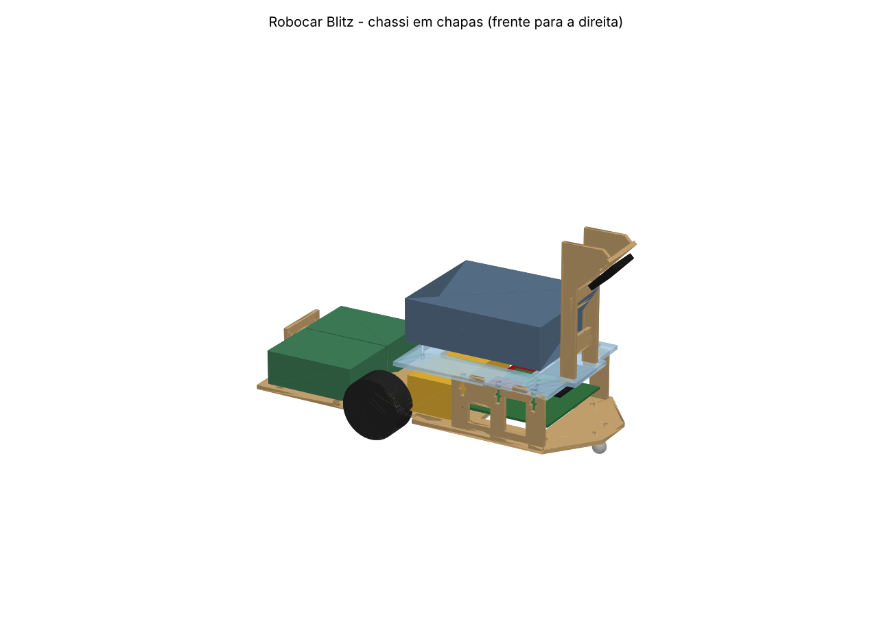

# Robocar Blitz — chassi em chapas cortadas a laser (v1)

Chassi de dois andares, todo em **MDF de 3 mm**. O andar 2 (o da Jetson) pode ser de **acrílico de 3 mm**.
As chapas se encaixam por **abas e rasgos** e são coladas, menos o andar 2, que vai **parafusado** para poder ser tirado.

| | |
|---|---|
| Tamanho | 246 × 123 mm em planta, contando as rodas (regra: máx. 250 × 150) |
| Massa das chapas | ≈ 79 g em MDF (o andar 2 em acrílico soma ≈ 11 g a mais) |
| Andar 1 | topo a 15 mm do chão: motores, bateria, os 2 XL4016, placa da ESP32, esfera |
| Andar 2 | a 50 mm do chão: Jetson em espaçadores M2.5 de 12 mm; mastro da câmera na frente |
| Câmera | centro a ~130 mm de altura, inclinada 45° para baixo |

## Arquivos

| Arquivo | Para quê |
|---|---|
| `corte/corte_TESTE_primeiro.dxf` | **Cortar primeiro:** pente de rasgos (2,70 a 3,10 mm) e furos M3/M2.5/M2 de teste |
| `corte/corte_MDF.dxf` | Todas as peças de MDF numa chapa de ~360 × 205 mm |
| `corte/corte_andar2.dxf` | Andar 2 sozinho (para cortar em acrílico ou MDF) |
| `corte/*_1x1.pdf` | Mesmo desenho em escala 1:1. Imprima em **100 %** (o de MDF pede folha A3) e confira a linha de 100 mm com a régua |
| `chassi_montado.step` | Modelo 3D com as chapas e as peças compradas (abre no Onshape, Fusion ou FreeCAD) |
| `fonte/chassi.py` | Script que gera tudo; muda espessura e folga e roda de novo |

Nos DXF, **vermelho (camada CORTE) = cortar** e **azul (camada GRAVAR) = gravar** (os nomes das peças; é opcional).

## Peças a cortar

| Peça | Qtd | Função |
|---|---|---|
| andar1 | 1 | base: suportes dos motores, esfera, cinta da bateria, abraçadeiras dos XL4016, placa da ESP32 |
| parede | 2 | ligam os andares; janela de alívio e janela para o cabo USB da ESP32 |
| andar2 | 1 | Jetson; furo grande no meio para os cabos subirem |
| poste_camera | 2 | mastro da câmera, já com a ponta cortada a 45° |
| travessa | 2 | degraus entre os dois postes (deixam o mastro firme) |
| placa_camera | 1 | onde a câmera é parafusada (marcação "CIMA ^" = topo da imagem) |
| painel_chave | 1 | painel traseiro com furo para a chave geral (19 × 13 mm, conferir a sua chave) |

## Passo a passo

1. **Medir a chapa com paquímetro.** "3 mm" costuma ser 2,7–3,0 mm.
2. **Cortar o teste** (`corte_TESTE_primeiro.dxf`). Encaixe a borda de um pedaço da chapa em cada rasgo do pente:
   - MDF: escolha o rasgo que entra **justo**, com pressão do dedo;
   - acrílico: escolha o que entra **folgado** (apertado trinca).
   Teste também os furos: o parafuso tem de passar sem forçar.
3. **Ajustar o desenho, se precisar:** a espessura (`T`) e a folga dos rasgos (`FOLGA`) são números no topo do
   `fonte/chassi.py`. Rodar de novo gera DXF novos. Hoje está T = 3,0 mm e rasgo = 2,9 mm.
4. **Imprimir o PDF 1:1 e pôr as peças reais em cima** (suporte do motor, esfera, Jetson, placa). Se algum furo não bater,
   ajuste antes de gastar chapa.
5. **Cortar.** Deixe o plástico protetor no acrílico. Nunca corte PVC e nunca deixe o laser sozinho.
6. **Montar a seco** e só depois colar:
   1. paredes no andar 1 (abas de baixo): **cola branca**, prender com prendedor 30–60 min;
   2. mastro: as 2 travessas entre os 2 postes, os postes nos rasgos do andar 2 e a placa da câmera no topo dos postes
      (MDF: cola branca; andar 2 de acrílico: **epóxi**);
   3. painel da chave nos rasgos de trás do andar 1;
   4. o andar 2 **não** é colado: **porca M3 presa** nas paredes (encaixe a porca no bolso da parede), 6 parafusos M3 × 12
      por cima do andar 2.
7. **Montar as peças:**
   - suportes dos motores com os parafusos M2 que vêm junto. Os furos são **oblongos** (17–21,6 mm entre centros) porque
     a distância exata do suporte branco não é publicada;
   - esfera por baixo, com os parafusos M2.5 dela;
   - placa da ESP32 em espaçadores M3 de 10 mm (laboratório). O furo do canto da frente à esquerda fica embaixo da ponta USB da ESP32: aperte os 4 parafusos **antes** de encaixar a ESP32;
   - Jetson em espaçadores M2.5 de 12 mm (comprados);
   - XL4016 com abraçadeira nos rasgos (e fita dupla face);
   - bateria com cinta de velcro de 20 mm pelos rasgos. Ela sai pelo lado, sem desmontar nada.

## Medidas usadas (e o que conferir)

| Peça | Medida usada | Fonte | Conferir? |
|---|---|---|---|
| Motor N20 | redutor 12 × 10 mm; eixo D de 3 mm com 10 mm | desenho da RoboCore | — |
| Suporte branco do N20 | 25 × 12 × 12 mm, parafuso M2; eixo ~6 mm acima da chapa | Smart Kits (SK1915) | **distância dos furos e altura do eixo** |
| Roda | 42 × 19 mm | Smart Kits | — |
| Esfera 3/8" | 15 mm de altura, furos M2.5 a 16 mm | desenho técnico da RoboCore | — |
| Jetson Nano | placa 100 × 80 mm; furos 86 × 58 mm | medida comum da placa P3449 | **sim**, com régua |
| Câmera IMX219-160 | placa 25 × 24 mm; furos M2 a 21 × 12,5 mm | formato da câmera do Raspberry Pi | **sim** |
| XL4016 | 65 × 46 × 24 mm | Smart Kits | — (vai de abraçadeira) |
| Bateria 3S 1100 | ~75 × 35 × 25 mm | estimado | **sim** |
| Placa da ESP32 v0.6 | 72,5 × 63 mm, 4 furos M3 nos cantos (3,5 mm das bordas) | `hardware/placa_esp32` | — |

**Esfera 3 mm mais alta.** Com o motor em cima da chapa, o andar 1 fica a 12 mm do chão por baixo. A esfera tem 15 mm,
então a frente fica 3 mm mais alta: o carro inclina ~1,3° para trás. Isso não atrapalha (a calibração da câmera
absorve). Para zerar, seria preciso pendurar os motores embaixo da chapa, o que sobe o carro inteiro.

**Comprimento:** 246 mm de 250 permitidos. Se precisar encurtar, aproxime os XL4016 do eixo ou baixe a câmera.

## Parafusos e miudezas

| Item | Qtd | Origem |
|---|---|---|
| Parafuso M3 × 12 + porca | 6 | andar 2 nas paredes |
| Parafuso M3 × 16 + porca, espaçador M3 10 mm | 4 | placa da ESP32 (laboratório) |
| Espaçador M2.5 12 mm + parafusos | 4 | Jetson (comprado) |
| Parafuso M2 × 8 + porca | 4 | câmera |
| Parafusos M2 dos suportes, M2.5 da esfera | — | vêm com as peças |
| Abraçadeiras finas (até 3,6 mm), velcro 20 mm | 4 + ~25 cm | laboratório |
| Cola branca (MDF), epóxi 5 min (acrílico) | — | |

## Como mudar o desenho

Tudo sai do `fonte/chassi.py` (Python + CadQuery + ezdxf). Medidas como `BITOLA`, `H_PAREDE`, a posição da câmera `Q`,
`T` e `FOLGA` estão no topo. Rodar `python3 chassi.py saida` refaz os DXF, os PDF, o STEP e as imagens. O STEP também
pode ser importado no Onshape (`fonte/onshape_upload.py` faz isso pela API).

## Abrir no Onshape (sem chave de API)

1. No Onshape: **Create → Import** (ou o botão de importar na lista de documentos) e escolha `chassi_montado.step`.
2. Espere a tradução: abre um documento com um **Assembly** (o carro montado) e um **Part Studio** com cada chapa como peça.
3. Para ver a placa da ESP32 no lugar, importe também `hardware/placa_esp32/placa_esp32.step` no mesmo documento
   (aba **+ → Import**) e posicione no Assembly: a borda da frente da placa fica em x = 118 mm, 25 mm acima do chão.
4. Os DXF de `corte/` podem ser anexados no mesmo documento (aba **+ → Import**), só para guardar junto.
5. Para mandar uma chapa editada ao laser: no Part Studio, clique com o botão direito na face da chapa → **Export as DXF/DWG**.
