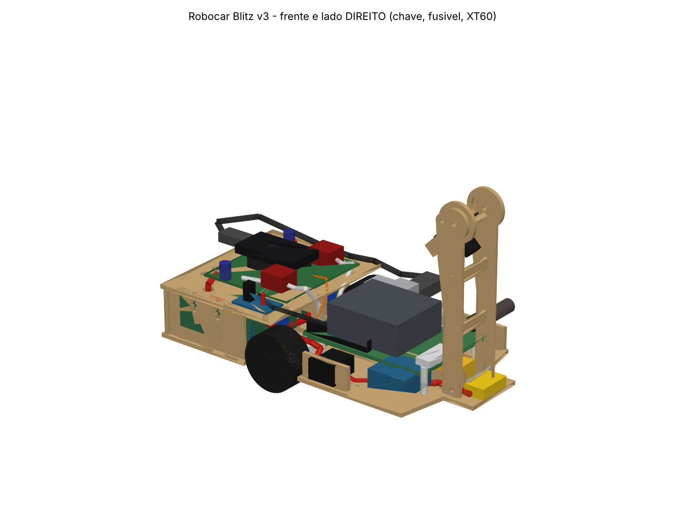

# Robocar Blitz — chassi v3 (substituído pelo [v4, 3 andares](../chassi_v4/))

> **Não cortar este.** O v3 media 240 mm (perto do limite de 250); o [v4](../chassi_v4/) tem 162 mm. Este fica como referência: análise, botão de desligar e o roteiro de montagem continuam valendo onde o v4 aponta para cá.

MDF 3 mm cortado a laser, **uma chapa de 390 × 270 mm**. Tudo sai de `fonte/` (Python + CadQuery + ezdxf): o
`make chassi` gera os arquivos e **para com erro se qualquer verificação falhar**.



| | v3 |
|---|---|
| Tamanho total (com plugues, cabos e câmera em toda a faixa) | **240 × 140 × 154 mm** |
| Massa estimada | **633 g** (pesar: ver [Pesos](#7-pesos)) |
| Centro de massa (x à frente do eixo / y / altura) | **16,8 / −1,0 / 36,1 mm** |
| Peso nas rodas de tração | **86 %** |
| Tomba com / escorrega com (μ = 0,9) | **1,11 g / 0,90 g**: escorrega antes de tombar |
| Levanta a esfera (empina) com | 0,47 g → `controle.acel_max` = 2,0/s (≈ 0,4 g) |
| Peças de MDF | 18 (14 desenhos) |
| Verificações automáticas | 52, todas ok (interferência: 96 sólidos dois a dois, 14 deles volumes de acesso; câmera: 9 ângulos; 6 releem o DXF gravado) · 28 testes negativos, todos pegos · 10 medidas a conferir |

## 1. Arquitetura e tamanho ([D-026](../../docs/decisoes.md))

```
 trás ◄──────────────────────────────────────────────────────────────────────────────► frente
  x = -98          -24      0 (eixo)    12                                   112   121  141
   ┌─ tampo: placa da ESP32 + placa de desligar ─┐
   │ caixa: XL4016 #1 (esq) | quilha | XL4016 #2  │ motores │ Jetson (portas p/ a ESQUERDA)      │mastro
   └──────────────────────────────────────────────┘  rodas  │ túnel da bateria embaixo (sai p/ frente)│esfera
```

* **Jetson baixa**, entre as rodas e à frente do eixo, com os 100 mm no sentido do carro: placa a 38 mm do chão
  (na v1/v2 ficava no 2º andar, a 60–65 mm). É a peça mais pesada (141 g); baixá-la é o que mais abaixa o CG.
* **Bateria embaixo da Jetson**, deitada no sentido do carro, num túnel de 2 trilhos. Sai **pela frente**, entre os
  postes do mastro. Fica longe dos XL4016 quentes e põe 70 g à frente do eixo (sem isso o carro empinaria).
* **Caixa traseira** com os 2 XL4016 no chão, bornes virados para o eixo e trimpots para trás. O **tampo** é o
  "andar de cima": leva a placa da ESP32 (sobre o eixo, como na D-024, a 42 mm do piso: os cabos dos motores
  passam embaixo) e a placa de desligar. Sai com 4 parafusos **sem mexer na Jetson**.
* **Quilha central** (espinha de 3 mm em pé) da parede traseira até a Jetson: é a viga que faltava na região do
  eixo, onde a v1 era bamba. Ela também segura o tampo no meio e tem a janela dos fios que cruzam de lado.
* **Pisos sobrepostos**: o traseiro (z 12–15) leva motores e caixa; o dianteiro (z 15–18) fica **por cima** dele
  de x = 13 a 35 (colado + 2 parafusos + os 2 espaçadores de trás da Jetson). Com o motor no suporte (eixo 6 mm
  acima da base), a face de baixo do piso dianteiro fica a 15 mm do chão: **a esfera de 15 mm encaixa sem calço**
  e o carro fica nivelado (na v1 ficava 3 mm torto).

Comparação com as mesmas peças e massas ([analise.md](analise.md), `fonte/analise.py`):

| | CG altura | Tomba com | Empina com | Limite em R100 | Volta 20 m* | Comprimento |
|---|---|---|---|---|---|---|
| A — Jetson no andar de cima | 45,5 mm | 0,97 g | 0,22 g | **tombamento** | 13,5 s | 246 mm |
| **B — v3** | **36,1 mm** | **1,11 g** | 0,47 g | aderência | 12,6 s | **240 mm** |
| C — Jetson no piso, bateria atravessada na frente | 33,1 mm | 1,14 g | 0,77 g | aderência | 12,4 s | **252 mm (> 250)** |

\* pista sintética, sem limite de controle; serve para comparar, não para prever.

Rigidez: a caixa traseira é fechada (piso, 2 paredes, parede traseira, quilha e tampo parafusado). O piso da frente
tem 2 nervuras (os trilhos) e as paredes laterais. Os encaixes usam o rasgo escolhido no pente e levam cola; o tampo,
os pisos, a Jetson e a placa vão parafusados. O apoio em 3 pontos (2 rodas + esfera) não torce o chassi parado.

## 2. Rodas ([D-027](../../docs/decisoes.md)): ficam as de 42 mm

| Roda | v em vazio (7,2 V) | Força de partida | Limite em R100 | Volta* | Problema |
|---|---|---|---|---|---|
| 32 mm (StickyMAX) | 1,51 m/s | 25 N | diferencial (0,96 m/s) | 15,0 s | eixo a 16 mm: a esfera de 15 mm fica 5 mm alta |
| **42 mm (temos 4)** | **1,98 m/s** | 19 N (4× a aderência) | aderência (0,94 m/s) | **12,6 s** | nenhum: já comprada, esfera encaixa sem calço |
| 48 mm | 2,26 m/s | 17 N | aderência | 12,0 s | CG +3 mm; não comprada |
| 65 mm | 3,06 m/s | 12 N | **tombamento** | 12,4 s | CG +11,5 mm |

* Nas curvas de R100 o limite é o pneu no tapete (~0,94 m/s com μ = 0,9), não o motor. A diferença das rodas maiores
  só aparece nas retas **acima de ~1,6 m/s**. Hoje o controle roda com `v_max` = 0,35 (≈ 0,7 m/s): com teto de
  1,2 m/s a volta é de 17,2 s com qualquer roda ≥ 42 mm.
* Torque sobra: a partida (19 N) é 4× o que o pneu consegue passar ao chão (4,8 N). A aceleração é limitada pela
  aderência e pelo empinar, não pelo motor.
* Vão livre: 12 mm atrás, 15 mm na frente (o regulamento da Micro não cita rampas nem desníveis; só a pista de
  borracha, com emendas).
* Pneu com mais atrito (μ > 1,0) faria o carro **tombar antes de escorregar** na R100 (tabela 4 de
  [analise.md](analise.md)). Por isso nada de pneu mais "grudento". Se o T12 medir μ > 1,0, limitar a velocidade na
  curva por software (~0,9 m/s em R100).
* **Comprar outra roda: não.** Rever só se os logs mostrarem o carro estável a `v_max` = 1,0 nas retas.

## 3. Botão de desligar a Jetson ([D-028](../../docs/decisoes.md))

Placa extra no tampo (lado direito): botão (segurar 2 s) e **LED vermelho que só apaga quando a Jetson terminou de
desligar** → só então desligar a chave. Serviço próprio (`botao-desligar.service`), independente do programa do robô
e da ESP32. A largada segurada 3 s continua como reserva. Esquema, peças, comparação das opções e roteiro de teste:
[hardware/placa_desligar/README.md](../../hardware/placa_desligar/README.md).

## 4. Temperatura ([D-029](../../docs/decisoes.md))

| Peça | Situação no v3 | O que medir | Aceitável |
|---|---|---|---|
| Jetson (dissipador passivo, 10 W a 25 °C) | nada em cima do dissipador (25 mm livres, verificado); carro andando faz vento | `sudo tegrastats --interval 1000 --logfile ~/teg.log` durante 15 min de `make carro` (rodas suspensas), modo `nvpmodel -m 0` (MAXN) | CPU e GPU **≤ 70 °C** a ~25 °C de ambiente (sobra margem para um ginásio mais quente) |
| XL4016 #1 (5,2 V, ~2 A: perde ~1,4 W) | na caixa, com vão de 6 mm até o tampo; entra ar pela frente, sai pelas **janelas da parede traseira** | termômetro ou dedo no dissipador depois dos 15 min | ≤ 60 °C (dá para segurar o dedo) |
| XL4016 #2 (7,2 V, ~1 A médio) | idem | idem; e depois do T09 (50 acelerações) | ≤ 60 °C |
| DRV8833 | no tampo, ao ar livre | dedo no chip depois do T09 | morno; se queimar o dedo, travamento de roda (stall) |
| Bateria | na frente, longe dos XL4016 | mão na bateria depois de 3 voltas | ≤ 40 °C, sem estufar |

* **Modo de potência:** usar MAXN (10 W) se o `tegrastats` ficar ≤ 70 °C. Se passar, medir antes o tempo de
  processamento no modo 5 W (`sudo nvpmodel -m 1`, depois `make benchmark`): se ficar abaixo de ~8 ms por quadro,
  o 5 W basta e esquenta menos.
* **Ventoinha de 40 mm:** só se passar de 70 °C no MAXN e o 5 W não servir. Ventoinha 4010 de 5 V no dissipador
  (parafusos M3 nos furos dele), ligada no J15 (header de ventoinha). O chassi já deixa o espaço livre. Custa
  ~10 g a 75 mm de altura (CG +0,6 mm).
* As únicas aberturas "de ar" do chassi são as 2 janelas da parede traseira (saída de ar dos XL4016, e por elas se
  veem as placas). Não há recorte decorativo.

## 5. Ergonomia de corrida

| Operação | Como | Onde |
|---|---|---|
| **Trocar a bateria** (~15 s) | chave OFF → separar o par XT60 (solto, na frente) → puxar o pino de trava pelo lado esquerdo → deslizar a bateria para a frente; ao contrário para pôr | frente, entre os postes |
| Chave geral | gangorra na parede direita | lado direito, atrás da Jetson |
| Largada | botão do J14 na placa da ESP32 (em cima do tampo, nada por cima) | tampo, centro-direita |
| Desligar a Jetson | botão da placa de desligar, 2 s; esperar o LED vermelho **apagar** | tampo, frente-direita |
| Trimpots dos XL4016 | chave de fenda pelos 4 furos de 7 mm do tampo, atrás da placa da ESP32 (verificado: nada no caminho) | tampo, traseira (XL1 à esquerda) |
| Ângulo da câmera (25–65°) | soltar as 2 porcas borboleta, girar, ler o número gravado em cima do pivô (alinhado com a marca "v" do poste), apertar | topo do mastro |
| Gravar a ESP32 | USB-C na traseira da placa (trocar o cabo da Jetson pelo notebook, ou gravar pela Jetson) | tampo, traseira |
| SSH | Wi-Fi (adaptador na USB livre) ou Ethernet; portas da Jetson para fora, lado esquerdo | lado esquerdo |
| microSD | sai pela borda direita da Jetson; a parede direita só vai até x = 64 (verificado) | lado direito, meio |
| Tirar o tampo sem mexer na Jetson | 4 M3 do tampo + 2 bornes OUT do XL4016 #2 + Dupont do VBAT e do J41 + 2 conectores dos motores + USB → tampo, ESP32 e placa de desligar saem juntos | tampo |
| Reparo: fusível | lado direito, embaixo da borda da Jetson (verificado) | piso dianteiro, direita |
| Reparo: motor / roda | roda: puxar. Motor: conector branco + 2 M2 do suporte (por baixo; com o tampo fora, por cima) | eixo |

Toda ligação entre módulos tem conector ou borne: XT60 (bateria), bornes (XL4016), P4 e USB (Jetson), conector branco
(motores), Dupont (VBAT, J41) e flat (câmera). O fusível fica a 5 cm do XT60, antes de tudo.

## 6. Fiação e montagem

Rotas, comprimentos de corte, bitolas, abraçadeiras e a **ordem de montagem** (com o que soldar antes de fechar a
caixa): [MONTAGEM.md](MONTAGEM.md). A tabela de cabos e os comprimentos saem do modelo
([verificacao.md](verificacao.md#cabos-rota-e-comprimento-de-corte)).

## 7. Pesos

A massa e o CG saem de `fonte/pecas.py` + a densidade do MDF. As estimativas que mais pesam no CG:

| Pesar (balança de cozinha) | Hoje | Por quê |
|---|---|---|
| **XL4016** (cada) | 45 g estimado (35–70) | 2 × 45 g atrás do eixo: ±20 g muda o CG em ±3 mm |
| **Placa da ESP32 montada, com os fios** | 40 g estimado | fica alta (z = 58 mm) |
| **Pente de teste cortado** (todas as peças de teste juntas) | densidade do MDF 0,75 g/cm³ | 18 peças = ~150 g de MDF; a densidade real varia 0,65–0,85 |
| Cabo USB, placa do fusível | 12 g, 8 g | menores |

Depois de pesar: trocar os valores em `fonte/pecas.py` (`xl_massa`, `esp_massa`, `massa_mdf_dens`…), rodar
`make chassi-verificar` e me mandar o resultado (o CG e o tombamento são refeitos e verificados).

## 8. Inspeção

Checklist do regulamento contra este projeto: [INSPECAO.md](INSPECAO.md).

## Arquivos

| Arquivo | Para quê |
|---|---|
| `corte/TESTE_cortar_primeiro.dxf` / `_1x1_A3.pdf` | **cortar primeiro**: pente de rasgos (2,70–3,10), furos M2/M2.5/M3/pino, porca presa, recorte da chave e **gabaritos de furação** da Jetson, do XL4016 e da placa da ESP32 (pôr a peça real em cima) |
| `corte/chapa_1.dxf` / `chapas_1x1_A3.pdf` | todas as peças (390 × 270 mm). Vermelho = cortar; azul = gravar. PDF em A3, imprimir em 100 % e conferir a régua de 100 mm |
| `chassi_montado.step` | modelo 3D com chapas, peças compradas, conectores e cabos (Onshape, Fusion, FreeCAD) |
| `verificacao.md` | resultado de cada verificação, tabela de cabos, massas e fixadores |
| `testes_negativos.md` | prova de que cada verificação pega o defeito plantado |
| `analise.md` | arquiteturas, rodas, sensibilidade ao atrito |
| `resumo.json` | números principais |
| `imagens/` | vistas 3D, faixa da câmera, desenho das chapas |
| `fonte/pecas.py` | **medidas e massas das peças compradas, com a origem de cada número** |
| `fonte/modelo.py` | o chassi (parâmetros no topo: `PADRAO`) |
| `fonte/verificacoes.py`, `fonte/testes_negativos.py` | verificações e testes delas |
| `fonte/gerar.py`, `fonte/analise.py`, `fonte/render.py`, `fonte/geometria.py` | saídas, análise, imagens, utilitários |

Comandos (na raiz do repositório):

| Comando | O que faz |
|---|---|
| `make chassi` | verifica e gera tudo (~30 s) |
| `make chassi-verificar` | só verifica e mostra massa, CG e tombamento |
| `make chassi-cortar` | como o anterior, mas **medida estimada que muda o corte vira erro**: rode antes de ir ao laser |
| `make chassi-negativos` | roda os testes negativos (~2 min) |
| `T=2.85 FOLGA=-0.1 make chassi` | espessura medida e folga escolhida no pente |

## Peças de MDF

| Peça | Qtd | Função |
|---|---|---|
| piso_traseiro | 1 | suportes dos motores, XL4016, caixa traseira |
| piso_dianteiro | 1 | Jetson, túnel da bateria, mastro, esfera |
| tampo | 1 | placa da ESP32, placa de desligar, furos dos trimpots, passa-fios do VM |
| parede_lateral | 2 | caixa traseira; bolsos das porcas presas do tampo |
| parede_traseira | 1 | fecha a caixa; janelas de saída de ar dos XL4016 |
| quilha | 1 | espinha central; janela dos fios; segura o tampo |
| trilho_bateria | 2 | guia da bateria e nervura do piso; furo do pino de trava |
| batente_bateria | 1 | encosto de trás da bateria |
| parede_frente_esq / _dir | 1 + 1 | laterais da frente; a direita leva a chave e a abraçadeira do feixe de energia |
| poste_mastro | 2 | mastro; pivô, trava do ângulo e furo do pino de trava |
| travessa_mastro | 2 | degraus que travam os postes |
| orelha_camera | 2 | giro da câmera: arco de ajuste e escala gravada |
| placa_camera | 1 | câmera presa por trás, a lente passa pelo furo |

Cada furo tem função (lista em `verificacao.md` → fixadores; abraçadeiras e passa-fios estão na rota dos cabos).

## Parafusos e compras

Fixadores contados pelos furos do desenho: tabela no fim de [verificacao.md](verificacao.md#fixadores-contados-pelos-furos).
Resumo do que comprar (Santa Ifigênia ou Smart Kits):

| Item | Qtd | Obs |
|---|---|---|
| Espaçador M2.5 × 20 mm fêmea-fêmea (nylon ou latão) | 4 | Jetson sobre a bateria. O pacote M2.5 comprado tem que medida? Se for 10 mm macho-fêmea, 2 empilhados servem |
| Parafuso M2.5 × 6 e M2.5 × 10 | 4 + 4 | Jetson |
| Parafuso M2.5 × 8 **cabeça chata** + porca | 2 | esfera (cabeça rente ao piso: a bateria passa por cima) |
| Parafuso M3 × 10 | 12 | |
| Parafuso M3 × 12 | 12 | |
| Porca M3 | 30 | |
| Porca borboleta M3 | 2 | ângulo da câmera, sem ferramenta |
| Espaçador nylon M3 × 5 mm / × 4 mm / × 3 mm | 4 / 8 / 2 | ESP32 / XL4016 / placa de desligar (laboratório; 2 porcas substituem o de 4 mm) |
| Parafuso M2 × 8 + porca | 4 | câmera |
| Chave táctil 6 × 6 mm com haste de 13 mm | 2 | botão de desligar (+1 reserva) |
| LED vermelho 3 mm | 2 | |
| Abraçadeira 2,5 mm | 1 pacote | rasgos de 3,5 × 1,5 mm |
| Fita dupla face espessa | 1 | placa do fusível no piso |
| Arame ou prego de 3 mm | 1 | pino de trava da bateria (dobrar em L) |
| *Opcional:* cabo USB-C 90° de 20 cm | 1 | alivia o conector da ESP32 (o plugue reto sai 22 mm para trás) |
| *Opcional:* plugue P4 90° | 1 | o cabo do P4 deixa de fazer a volta por fora da parede esquerda |

Não precisa comprar roda, motor, ventoinha (ver §4) nem esfera nova.

## O que ainda depende de medida

O `make chassi-cortar` lista e **barra** o corte enquanto estas medidas forem estimadas (`fonte/pecas.py`, origem `'E'`):

* **Jetson:** diâmetro dos furos e posição deles em relação às bordas (o 88 × 60 de borda a borda está usado; os
  centros saem de 88 − d e 60 − d, supondo furos centrados). Conferir no gabarito do pente.
* **XL4016:** posição dos 4 furos, altura total com dissipador, posição dos 2 parafusos dos trimpots e se eles
  regulam por cima (assumido) ou de lado; de que ponto a que ponto ficam os 4 bornes na largura.
* **Câmera:** furação (21 × 12,5 assumido), lado da base do suporte da lente (14 mm assumido) e diâmetro da lente.
* **Chave:** recorte da gangorra (19 × 13 mm assumido).
* Sem bloquear o corte, mas mudam as contas: comprimento do cabo dos motores (150 mm assumido), do flat da câmera
  (150 mm), dos fios do XT60 da bateria (70 mm), altura do eixo no suporte branco (6 mm), campo de visão vertical da
  câmera no modo 1280 × 720 (56° estimado).
