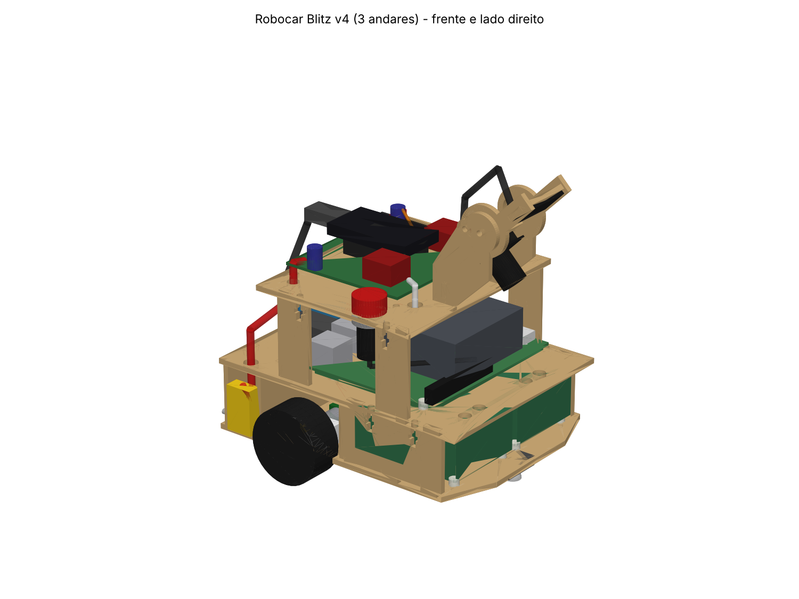

# Robocar Blitz — chassi v4 (3 andares) — **é este que vamos cortar**

| Chassi | Comprimento | Situação |
|---|---|---|
| v1 (`mecanica/chassi/`) | — | placa da ESP32 antiga (v0.7); não serve mais |
| v3 (`mecanica/chassi_v3/`) | 240 mm | a 10 mm do limite de 250; só referência |
| **v4 (este)** | **176 mm** (162 com a câmera em 45°) | 3 andares, todas as placas novas, luz da câmera, 70 verificações (21 de folga) |

**Por que o v4:** é o único que tem lugar para tudo o que existe hoje (placa de distribuição, botão de desligar,
luz da câmera) e passa em todas as verificações. É 64 mm mais curto que o v3 e, no desempate (§4.8), robô menor
ganha. O preço é o centro de massa mais alto: tomba com 0,76 g, por isso a curva é limitada no software a 0,65 g
(D-032).

**Furos:** os furos de fixação das peças compradas (Jetson, ESP32, XL4016, placa de distribuição, botão de desligar,
câmera, esfera, suportes dos motores) **não são cortados**. O laser só grava um círculo do tamanho do furo e uma
cruz no centro, e vocês furam com a parafusadeira conferindo com a peça (D-037). O laser continua cortando o que
tem de alinhar entre duas chapas (parafusos com porca presa, pivô e arco da câmera, pino da bateria), os encaixes,
os passa-fios e os recortes.

MDF 3 mm cortado a laser, 2 chapas de 390 × 270 mm. Substitui o [v3](../chassi_v3/) (240 mm de comprimento, muito
perto do limite de 250). Tudo sai de `fonte/` (Python + CadQuery + ezdxf): o `make chassi` gera os arquivos e
**para com erro se qualquer verificação falhar**.



| | **v4 (3 andares)** | v3 |
|---|---|---|
| Tamanho total (com plugues, cabos e câmera em toda a faixa) | **162 × 143 × 160 mm** | 240 × 140 × 154 mm |
| Folga até o limite de 250 × 150 | **88 mm** no comprimento, 7 mm na largura | 10 mm / 10 mm |
| Massa estimada | 670 g | 633 g |
| Centro de massa (x à frente do eixo / y / altura) | 21,6 / −1,6 / **50,5 mm** | 16,8 / −1,0 / 36,1 mm |
| Peso nas rodas de tração | 77 % | 86 % |
| Tomba com | **0,76 g** → curva R100 a no máximo **0,80 m/s** ([D-032](../../docs/decisoes.md)) | 1,11 g |
| Levanta a esfera com | 0,43 g (`controle.acel_max` = 2,0/s ≈ 0,4 g) | 0,47 g |
| Peças de MDF | 19 (14 desenhos) | 18 |
| Verificações | 70 ok (interferência com 13 volumes de acesso; **folga: 21 peças aumentadas além da medida ainda cabem**; câmera em 9 ângulos; 7 releem o DXF) · **34 testes negativos, todos pegos** · 1 medida a conferir no pente de teste (recorte da chave) | 52 · 28 |

## Folga: cabe com sobra, não só "sem encostar" (D-041)

A verificação de interferência só garante que nada se sobrepõe. A de **folga** pega 21 peças compradas, **aumenta
cada uma além da medida** nos lados livres (≈ 1 mm nas medidas da equipe; a faixa das lojas nas estimadas: XL4016 até
26 mm de altura, chave 2 mm mais funda, plugues 3 mm mais longos, botão 3 mm mais comprido…) e confere que ainda cabe
no corte **nominal**. Resultado: todas cabem. Folgas que sobram, por exemplo: XL4016 ↔ parede 5,3 mm; bateria no berço
0,5 mm de cada lado (proposital: ela não pode chacoalhar); trilho do pino de trava, conectores dos motores e encoders ≥ 1 mm.

## Peças compradas como estão no modelo

Não são fotos: é o desenho que o chassi usa para cada peça, com as medidas e de onde veio cada uma (medido, documento ou **ESTIMADO**). Ponha a peça real ao lado: o que estiver estimado e for diferente, corrija em `fonte/pecas.py` e rode `make chassi`. A placa da ESP32 é o render do KiCad da placa de vocês.


## 1. Quem fica em cada andar ([D-031](../../docs/decisoes.md))

```
 z (mm)
 99-102   ANDAR 3  placa da ESP32 (largada, USB, LED e EN/BOOT por cima) + botão de desligar + mastro curto da câmera
 50-53    ANDAR 2  Jetson de través (100 mm na largura), portas para TRÁS; atrás dela: placa de distribuição (fusível)
 12-18    ANDAR 1  motores no eixo · 2 XL4016 à frente do eixo · bateria atravessada atrás (sai pela direita) + chave
          trás ◄── x = −56 ─────── 0 (eixo) ─────────────────────────── 106 ──► frente
```

| Andar | Por quê |
|---|---|
| 1: XL4016 + bateria | são ~160 g: o mais baixo possível. Os XL4016 ficam à frente do eixo, com os bornes virados para ele e os trimpots para a frente, onde o andar 2 tem furos de 7 mm para a chave de fenda. A bateria fica atravessada atrás da roda e sai pela direita em segundos |
| 2: Jetson | é a peça mais pesada (141 g): no meio, não em cima. Com 100 mm na largura e as portas para trás, os plugues P4 e USB ficam **dentro do comprimento** e o carro não alarga |
| 3: ESP32 | é a mais leve (40 g) e a que se usa na corrida: largada, LED, USB de gravação e EN/BOOT ficam por cima, sem tirar nada. Os cabos para a Jetson, os motores e o botão de desligar são curtos |

Comparação das ordens possíveis, com as mesmas peças ([analise.md](analise.md)):

| Ordem | CG | Tomba com | Comprimento | Problema |
|---|---|---|---|---|
| **XL4016 + bateria / Jetson / ESP32 (escolhida)** | 50,5 mm | 0,76 g | 162 mm | precisa de limite de curva por software |
| XL4016 + bateria / ESP32 / Jetson | 57,1 mm | 0,67 g | 162 mm | tomba ainda antes; largada e USB da ESP32 embaixo da Jetson |
| Jetson / XL4016 / ESP32 | 47,8 mm | 0,87 g | 177 mm | XL4016 aquecendo em cima do dissipador da Jetson; mais longo |

**O custo dos 3 andares é o CG mais alto.** O carro tomba (levanta uma roda) com 0,76 g de aceleração lateral, antes
dos 0,9 g em que o pneu escorrega. Por isso a curva de R100 tem de ser feita a **no máximo 0,80 m/s** (0,65 g), o que
dá ~0,40 de `v` na escala do controle. Hoje o controle anda a `v_max` = 0,35 (≈ 0,7 m/s): está dentro. Ao subir a
velocidade, a regra é a da [D-032](../../docs/decisoes.md). Bitola de 124 mm (era 104): a base mais larga compensa
parte da altura e a largura total (143 mm) continua dentro dos 150.

## 2. Rodas

Ficam as de 42 mm ([D-027](../../docs/decisoes.md)): a análise da v4 dá o mesmo resultado
(seção 2 de [analise.md](analise.md)). Na v4 a curva é limitada pelo software (0,80 m/s) e não pelo motor.

## 3. Botão de desligar e luz da câmera (sem placa)

[hardware/placa_desligar/](../../hardware/placa_desligar/) ([D-028](../../docs/decisoes.md), D-040). Um **botão de
pulso de painel de 12 mm** fica preso com a porca no **andar 3, lado direito** (furo gravado em (40, −50), furar à mão);
o corpo fica embaixo do andar, e 3 jumpers vão direto ao J41 (pinos 17, 18 e 20; 68 mm de rota). O 10k e o 1k vão
soldados no botão. Sem LEDs. A **luz** (fita COB na placa da luz, em cima da câmera) vai no **USB da Jetson**, sem o
controle de toque; o cabo sobe por trás da câmera, preso nos passa-fios do VM e do motor esquerdos e na travessa do
mastro (~40 cm).

## 4. Temperatura

* Jetson: **11 mm livres em cima do dissipador** (verificado), com o andar 3 por cima e os lados abertos; andando, o ar
  passa de frente para trás. É menos ar que no v3 (dissipador aberto): **medir antes de correr** (T16:
  `tegrastats` ≤ 70 °C em 15 min de `make carro`). Se passar, a ventoinha 4010 de 5 V cabe nos 11 mm (J15) sem mudar
  o chassi; outra opção é o modo 5 W.
* XL4016: no andar 1, com 4 mm até o andar 2; frente e lados abertos.
* Bateria: atrás, longe dos XL4016.

## 5. Ergonomia de corrida

| Operação | Como | Onde |
|---|---|---|
| **Trocar a bateria** | chave OFF → separar o par XT60 (em pé, na ponta direita da bateria) → puxar o pino de trava por trás → deslizar a bateria para a direita | lado direito, atrás da roda |
| Chave geral | gangorra na parede de trás do berço | traseira, à esquerda |
| Largada | botão do J14, por cima | andar 3 |
| Desligar a Jetson | botão de painel, 2 s; esperar a luz e o LED de energia da ESP32 apagarem (ou 30 s depois do LED de estado; T15); só então a chave geral | andar 3, direita |
| Trimpots dos XL4016 | chave de fenda **curta** (≤ 40 mm) pelos 4 furos de 7 mm do andar 2, na frente da Jetson | frente, entre os andares 2 e 3 |
| Ângulo da câmera (25–65°) | soltar as 2 porcas borboleta, girar, ler o número gravado em cima do pivô, apertar | topo do mastro |
| Gravar a ESP32 | USB-C na traseira da placa | andar 3, trás |
| SSH | Wi-Fi (adaptador na USB livre) ou Ethernet: as portas da Jetson ficam viradas para trás | andar 2, trás |
| microSD | sai pela borda da frente da Jetson, entre os andares 2 e 3 (verificado) | frente |
| Fusível | por cima, atrás do andar 3 (verificado); LED verde da placa de distribuição = chave ligada | andar 2, trás |
| Tirar o andar 3 sem mexer na Jetson | 4 parafusos M3 (porcas presas nos pilares) + Dupont do VBAT + conectores dos motores + USB | andar 3 |
| Tirar a Jetson com o andar 2 | 4 parafusos M3 do andar 2 (porcas presas nas paredes do andar 1) + P4 + flat; a Jetson sai parafusada no andar 2 | andar 2 |

## 6. Fiação, montagem e inspeção

[MONTAGEM.md](MONTAGEM.md) traz os cabos (rota, corte, apoio) e a ordem de montagem. A tabela é gerada pelo modelo em
[verificacao.md](verificacao.md). [INSPECAO.md](INSPECAO.md) traz o checklist do regulamento.

**Atenção:** os fios do VM já soldados na placa da ESP32 precisam ter **≥ 216 mm (esquerdo) e ≥ 156 mm (direito)** na v4 (D-034),
porque a placa está no andar 3. Se forem mais curtos, emende com 0,75 mm² e termorretrátil.

## 7. Pesos

O mesmo do v3: pesar os XL4016, a placa da ESP32 montada e as peças do pente de teste; trocar em `fonte/pecas.py`;
`make chassi-verificar`. Na v4 o que mais pesa no tombamento é a altura: a ESP32 e a Jetson. Mande o resultado.

## Arquivos e comandos

Mesma organização do v3 (ver [o README do v3](../chassi_v3/README.md#arquivos)). Peças:

| Peça | Qtd | Função |
|---|---|---|
| piso_traseiro / piso_dianteiro | 1 + 1 | motores e berço / XL4016 e esfera (sobrepostos: esfera de 15 mm sem calço) |
| parede_berco_tras | 1 | berço da bateria, apoio do andar 2, chave geral, furo do pino |
| parede_berco_frente | 1 | berço, apoio do andar 2, furo do pino, janela dos fios da chave |
| parede_berco_esq | 1 | batente esquerdo da bateria |
| parede_frente | 2 | laterais do andar 1; porcas presas do andar 2 |
| andar2 | 1 | Jetson, placa de distribuição, furos dos trimpots e passa-fios |
| pilar_tras / pilar_frente | 2 + 2 | sustentam o andar 3; porcas presas |
| andar3 | 1 | placa da ESP32, botão de desligar, mastro |
| poste_mastro, travessa_mastro | 2 + 1 | mastro curto da câmera |
| orelha_camera, placa_camera | 2 + 1 | giro da câmera; a câmera vai **na frente** da placa, em 4 espaçadores de 5 mm (D-041) |

Fixadores contados pelos furos: [verificacao.md](verificacao.md#fixadores-contados-pelos-furos). Em relação ao v3, a v4
**não precisa** de espaçadores M2.5 de 20 mm nem de parafusos de cabeça chata: são 4 espaçadores M2.5 de 5 mm, 8 porcas
presas (andares 2 e 3) e um pino de trava de 35 mm.

Medidas que ainda dependem de você: as mesmas do v3 (`make chassi-cortar` barra até conferir), e ficou mais
importante o **comprimento do cabo dos motores** (a v4 precisa de ~125 mm até a placa no andar 3; assumi 150).
